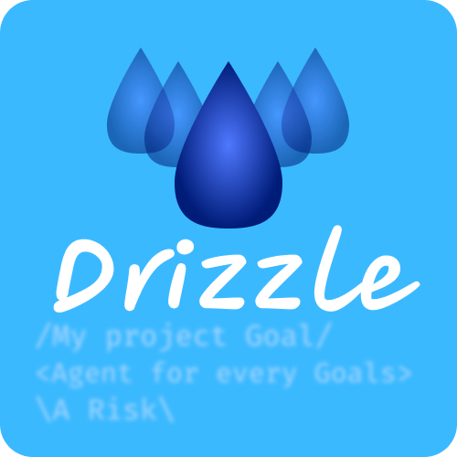

<div align="center">
    
    <h1>A Simple RED Language Support</h1>
</div>

Drizzle adds syntax highlighting for Lamda RED requirements diagrams.

## Demo

<div align="center">
    
</div>

## Sample

```drizzle
&& Train control requirements
Estimate @0,0 = /Accurate estimate\nof speed & position/
Tracking @1,0 = <Tracking system>
Train @2,0 = [Train]
Duty @0,1 = {Train controller responsibility\nCompute safe acceleration for all trains between this station and the next.}
Safe @0,2 = /Safe command\nmessage/
Controller @1,2 = <Train controller>
Timing @0,3 = /Command in time/
Send @1,3 = (Send\ncommand)
Command @2,3 = [Command]

Estimate __ Tracking [o]
Tracking __> Train : currentSpeed\ncurrentLocation
Tracking <__ Train : measuredSpeed\nmeasuredLocation
Train __> Controller : As monitor\nmeasuredSpeed\nmeasuredLocation
Controller __> Command : As control\ncommandedSpeed\ncommandedAccel
Safe __ Controller [o]
Timing __ Controller [o] : Responsibility
Controller __ Send [o] : Performance
Duty --> Controller
```

## Output

<div align="center">
    
</div>

See the [Lamda RED syntax guide](https://github.com/Asncodes-80/lamda_red#drizzle-syntax) for goal trees,
shape types, connection markers, and layout controls.

## Release Notes

### 1.1.3

- Fix Marketplace image URLs for the logo, syntax demo, and rendered output.
- Link directly to the complete Drizzle guide in the repository README.

### 1.1.0 - 1.1.2

- Extend the Pest grammar with named nodes, forward references, UTF-8 labels,
  escapes, line breaks, and line-and-column diagnostics. Preserve anonymous
  goal, risk, and agent declarations and whole-line comments.
- Add objects, actions, notes, cloud annotations, descriptive trapezoids, and
  diamonds. Support thick outlines for leaves such as requirements and
  assumptions.
- Add solid and dashed links, optional arrowheads at either or both ends,
  labels, self-loops, and shared refinement junctions. Draw open and filled
  circles, conflict zigzags, and obstacle crossbars.
- Add four layout directions, explicit column and row placement, orthogonal
  routes, and outer detours. Separate parallel links and attach arrows to
  shape boundaries.
- Update the VS Code grammar and extension README, replace the old GIF demo
  with a PNG, and include the Drizzle 1.1.0 VSIX.

### 1.0.0

Initial release of Drizzle
