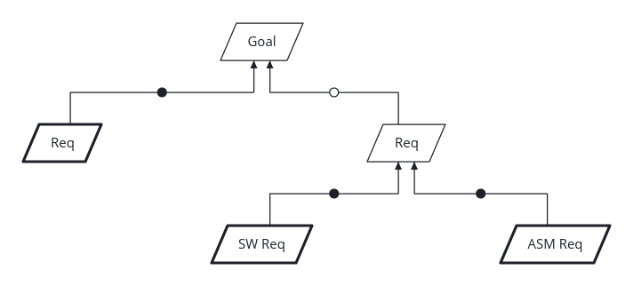
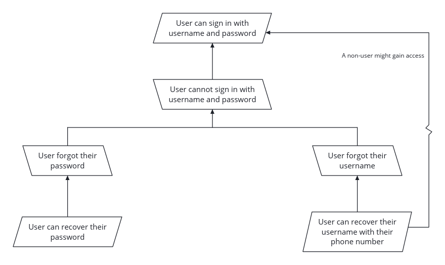

<div align="center">
    
    <h1>Lamda RED</h1>
    <p>
        <a href="../en/README.md">English</a> ·
        <a href="../ru/README.md">Русский</a> ·
        <a href="../fa/README.md">فارسی</a> ·
        <a href="../ar/README.md">العربية</a> ·
        <a href="../tr/README.md">Türkçe</a> ·
        <a href="../zh-CN/README.md">简体中文</a> ·
        <a href="../de/README.md">Deutsch</a> ·
        <a href="../es/README.md">Español</a> ·
        <a href="../ko/README.md">한국어</a>
    </p>
    <p>Diagramme für das Requirements Engineering aus Drizzle-Quelldateien erstellen.</p>
</div>

Lamda RED ist ein in Rust geschriebener Compiler für Drizzle, eine Textsyntax für Ziele, Risiken, Agenten und deren Beziehungen. Das Projekt entstand, um das Zeichnen von Anforderungsdiagrammen mit der Maus in draw.io und Microsoft Visio zu ersetzen. Drizzle soll neben PlantUML in Projekten des Requirements Engineering und Software Engineering einsetzbar sein.

Der Compiler wird als `lmdred` bereitgestellt. Version `1.1.0` erzeugt PNG und bearbeitbares mxGraph-XML aus demselben Diagrammlayout.

- [Quellcode und Entwicklung](#source-and-development)
  - [Quellcode vorbereiten](#set-up-the-source)
  - [Ausführen und debuggen](#run-and-debug)
  - [Tests und Prüfungen](#test-and-check)
  - [Build und Paketierung](#build-and-package)
  - [Ein Compiler-Release veröffentlichen](#publish-a-compiler-release)
- [Installation](#installation)
- [CLI verwenden](#cli-usage)
- [Drizzle-Syntax](#drizzle-syntax)
- [Drizzle-Erweiterung für VS Code](./vscode.md)
- [Änderungsprotokoll](./CHANGELOG.md)
- [Geplante Arbeiten](#roadmap)
- [Lizenz](#license)

<a name="source-and-development"></a>

## Quellcode und Entwicklung

Der Compiler liest eine UTF-8-Quelldatei, analysiert Knoten und Verbindungen, vermisst Beschriftungen, berechnet Layout und Verbindungspfade und exportiert das Diagramm.

| Pfad | Aufgabe |
| --- | --- |
| [src/main.rs](../../src/main.rs) | CLI-Argumente, Dateipfade, Fehler und Kompilierungsschritte |
| [src/lamda_red_grammar.pest](../../src/lamda_red_grammar.pest) | Drizzle-Grammatik |
| [src/parsing.rs](../../src/parsing.rs) | Diagrammmodell, Deklarationen, Verweise und Syntaxdiagnose |
| [src/labels.rs](../../src/labels.rs) | Schriftsuche, Textformung, Zeilenumbruch und Kürzung |
| [src/layout.rs](../../src/layout.rs) | Formgeometrie, Rasterpositionen und Grenzen der Zeichenfläche |
| [src/routing.rs](../../src/routing.rs) | Verbindungen, Verzweigungen, Umwege und Positionen der Verbindungsbeschriftungen |
| [src/export.rs](../../src/export.rs) | Erzeugung von PNG und mxGraph-XML |
| [sample.zz](../../sample.zz) und [sample/](../../sample/) | Zugsteuerung und weitere Referenzdiagramme |
| [tests/test_cli_install.py](../../tests/test_cli_install.py) | Integrationstests für CLI und Release-Installer |
| [scripts/](../../scripts/) | Installer und Erstellung von Release-Archiven |
| [.github/workflows/release-cli.yml](../../.github/workflows/release-cli.yml) | Builds, Prüfungen und Releases für sechs Plattformziele |
| [drizzle/](../../drizzle/) | VS-Code-Erweiterung für Syntaxhervorhebung |

<a name="set-up-the-source"></a>

### Quellcode vorbereiten

Installieren Sie eine aktuelle stabile Rust-Toolchain, Cargo und die nativen Build-Werkzeuge der Plattform. Die Integrationstests für CLI und Installer benötigen Python 3. Die Release-Paketierung läuft unter Windows PowerShell 5.1 oder PowerShell 7. Die PNG-Ausgabe verwendet installierte Systemschriften. [Rust installieren](https://www.rust-lang.org/tools/install).

```sh
git clone https://github.com/Asncodes-80/lamda_red.git
cd lamda_red
cargo build --locked
```

MSVC-Builds unter Windows benötigen die Visual Studio C++ Build Tools. Installieren Sie unter macOS die Xcode Command Line Tools und unter Linux einen C-Compiler und Linker. Minimale Linux-Umgebungen benötigen zusätzlich eine Schrift wie DejaVu Sans.

Verwenden Sie unter Windows mit der GNU-Toolchain die folgenden Befehle. In den übrigen Build-, Start-, Test- und Installationsbefehlen können Sie `+stable-x86_64-pc-windows-gnu` direkt nach `cargo` einsetzen.

```powershell
rustup toolchain install stable-x86_64-pc-windows-gnu --profile minimal --component clippy,rustfmt
cargo +stable-x86_64-pc-windows-gnu build --locked
```

Belassen Sie `Cargo.lock` in der Versionsverwaltung und verwenden Sie `--locked`, um mit den eingecheckten Abhängigkeitsversionen zu arbeiten.

<a name="run-and-debug"></a>

### Ausführen und debuggen

Cargos Entwicklungsbuild enthält Debug-Informationen. Kompilieren Sie mit folgendem Befehl ein Referenzdiagramm.

```sh
cargo run --locked -- sample/requirements.zz target/requirements
cargo run --locked -- --help
cargo run --locked -- --version
```

Der erste Befehl schreibt `target/requirements.png` und `target/requirements.xml`. Ein Aufruf von `cargo run --locked` ohne weitere Argumente liest `sample.zz` und schreibt `output.png` und `output.xml` in das Stammverzeichnis des Repositorys.

Öffnen Sie zum Debuggen in VS Code das Stammverzeichnis, installieren Sie CodeLLDB und ergänzen Sie `.vscode/launch.json` um die folgende Konfiguration. Sie baut `lmdred` mit Cargo und öffnet das Beispiel über Pfade relativ zum Repository. [CodeLLDB-Konfigurationsreferenz](https://github.com/vadimcn/codelldb/blob/master/MANUAL.md#cargo-support).

```json
{
  "version": "0.2.0",
  "configurations": [
    {
      "name": "Debug lmdred",
      "type": "lldb",
      "request": "launch",
      "cargo": {
        "args": ["build", "--locked", "--bin", "lmdred"],
        "filter": { "name": "lmdred", "kind": "bin" }
      },
      "args": ["sample/requirements.zz", "target/debug-diagram"],
      "cwd": "${workspaceFolder}",
      "env": { "RUST_BACKTRACE": "1" },
      "sourceLanguages": ["rust"]
    }
  ]
}
```

Setzen Sie in der Funktion `run` in `src/main.rs` einen Haltepunkt und drücken Sie **F5**. Prüfen Sie das Modell in `parsing::parse`, Positionen und Pfade in `layout::arrange` und die Ausgabe in `export::png` oder `export::xml`. Um die GNU-Toolchain explizit auszuwählen, setzen Sie die Cargo-Argumente auf `["+stable-x86_64-pc-windows-gnu", "build", "--locked", "--bin", "lmdred"]`.

<a name="test-and-check"></a>

### Tests und Prüfungen

Führen Sie Rust-Tests, Formatprüfung und Linter im Stammverzeichnis aus.

```sh
cargo test --locked
cargo fmt --check
cargo clippy --locked --all-targets -- -D warnings
```

Die Rust-Tests prüfen Parsing und Verweise, Markierungen und Verzweigungen, Abwärtskompatibilität, die Wegführung um Hindernisse sowie Textumbrüche und Kürzung.

Bauen Sie für die Prüfung von CLI und Installern eine Release-Datei und übergeben Sie ihren Pfad an den Integrationstest.

```sh
cargo build --locked --release
python tests/test_cli_install.py --binary target/release/lmdred
```

Unter Windows verwenden Sie `target/release/lmdred.exe`. Bei einem expliziten Rust-Ziel verwenden Sie `target/<target>/release/lmdred` oder `lmdred.exe`. Der Integrationstest rendert außerhalb des Repositorys, prüft Pfade mit Leerzeichen und Standardausgaben und stellt ein Release-Archiv lokal über HTTP bereit. Er installiert und reinstalliert in einem temporären Verzeichnis und prüft, ob fehlerhafte Prüfsummen abgewiesen werden und die installierte Datei erhalten bleibt.

<a name="build-and-package"></a>

### Build und Paketierung

```sh
cargo build --locked
cargo build --locked --release
```

Entwicklungsbuilds liegen in `target/debug/`, optimierte Builds in `target/release/`. Die ausführbare Datei heißt unter Linux und macOS `lmdred` und unter Windows `lmdred.exe`.

Bauen Sie unter Windows zuerst das Ziel und paketieren Sie es dann mit Windows PowerShell 5.1. Unter PowerShell 7 verwenden Sie `pwsh` anstelle von `powershell.exe`.

```powershell
$compilerTarget = ((rustc -vV | Select-String '^host: ').Line -split ': ', 2)[1]
cargo build --locked --release --target $compilerTarget
powershell.exe -NoProfile -ExecutionPolicy Bypass -File .\scripts\package-release.ps1 -Target $compilerTarget
```

Beide Schritte verwenden das Ziel der aktiven Rust-Toolchain. Unter Windows x64 ist das `x86_64-pc-windows-msvc` oder `x86_64-pc-windows-gnu`. Die ausführbare Datei liegt in `target/<target>/release/`. Archiv und `.sha256`-Datei werden nach `target/dist/` geschrieben. Jedes Archiv enthält die ausführbare Datei, Lizenz, README und `sample.zz`. Unix-Ziele verwenden `.tar.gz`-Archive.

<a name="publish-a-compiler-release"></a>

### Ein Compiler-Release veröffentlichen

Der Release-Workflow baut und testet native x64- und ARM64-Dateien für Windows, macOS und Linux. Er lädt Plattformarchive, SHA-256-Prüfsummen, beide Installationsskripte und die zusammengefasste Datei `SHA256SUMS` hoch.

Nachdem der Quellcode eingecheckt und gepusht wurde, veröffentlichen Sie einen Tag passend zur Version in `Cargo.toml`.

```sh
git tag lmdred-v1.1.0
git push origin lmdred-v1.1.0
```

Der Tag startet den Workflow, der nach erfolgreichen Builds das Compiler-Release erzeugt. Auch ein manuell veröffentlichtes GitHub-Release mit demselben Compiler-Tag startet den Workflow und erhält dessen Dateien. **Run workflow** erzeugt herunterladbare Actions-Artefakte für den gewählten Branch.

Aktualisieren Sie vor weiteren Releases die Compilerversion in `Cargo.toml` und `Cargo.lock`, die Standardversion beider Installer und die versionsgebundenen Installationsbefehle in der README. Pushen Sie dann den passenden Tag. Compiler-Tags beginnen mit `lmdred-v`. Die VS-Code-Erweiterung verwendet `drizzle-`-Tags und eine eigene Version in `drizzle/package.json`.

<a name="installation"></a>

## Installation

Die folgenden Befehle laden das Compiler-Release `lmdred-v1.1.0`, sobald der Workflow seine Dateien hochgeladen hat.

Die Installer wählen x64 oder ARM64, laden Archiv und SHA-256-Prüfsumme herunter, prüfen das Archiv und installieren `lmdred` im Benutzerkonto. Führen Sie den Installer für ein Upgrade oder eine Reparatur erneut aus.

<a name="linux-and-macos"></a>

### Linux und macOS

Laden Sie das Shell-Installationsskript mit curl herunter und führen Sie es aus.

```sh
curl -fL https://github.com/Asncodes-80/lamda_red/releases/download/lmdred-v1.1.0/install.sh -o install-lmdred.sh
sh install-lmdred.sh
```

Zum Herunterladen können Sie auch wget verwenden.

```sh
wget https://github.com/Asncodes-80/lamda_red/releases/download/lmdred-v1.1.0/install.sh -O install-lmdred.sh
sh install-lmdred.sh
```

Das Standardverzeichnis ist `$HOME/.local/bin`. Der Installer aktualisiert `~/.profile` und die Startdateien der aktuellen Bash-, Zsh- oder Fish-Shell. Öffnen Sie nach der Installation ein neues Terminal. In Bash, Zsh oder sh können Sie den Befehl auch sofort im aktuellen Terminal verfügbar machen.

```sh
export PATH="$HOME/.local/bin:$PATH"
lmdred --version
```

Wählen Sie die Version oder das Installationsverzeichnis mit diesen Optionen.

```sh
sh install-lmdred.sh --version 1.1.0 --bin-dir "$HOME/.local/bin"
sh install-lmdred.sh --no-modify-path
```

Die Umgebungsvariablen `LMDRED_VERSION` und `LMDRED_INSTALL_DIR` legen Standardwerte fest. Explizite CLI-Optionen haben Vorrang. Ergänzen Sie bei anderen Shells das Startprofil um das Installationsverzeichnis.

<a name="windows"></a>

### Windows

Laden Sie den Installer über PowerShell herunter und führen Sie ihn aus.

```powershell
$installer = Join-Path $env:TEMP 'install-lmdred.ps1'
Invoke-WebRequest -Uri 'https://github.com/Asncodes-80/lamda_red/releases/download/lmdred-v1.1.0/install.ps1' -OutFile $installer
powershell -NoProfile -ExecutionPolicy Bypass -File $installer
```

Öffnen Sie ein neues Terminal und führen Sie `lmdred --version` aus. Der Installer legt die Datei in `%LOCALAPPDATA%\Programs\lmdred\bin` ab und setzt dieses Verzeichnis an den Anfang des Benutzer-PATH. Damit hat es Vorrang vor einer Cargo-Installation. Hat eine systemweite Kopie Vorrang, meldet der Installer deren Pfad. Mit `Get-Command lmdred -All` prüfen Sie, welche Kopie das Terminal verwendet.

Wählen Sie mit diesen Optionen einen anderen Pfad oder konfigurieren Sie PATH selbst.

```powershell
powershell -NoProfile -ExecutionPolicy Bypass -File $installer -Version 1.1.0 -InstallDirectory "$env:LOCALAPPDATA\Programs\lmdred\bin"
powershell -NoProfile -ExecutionPolicy Bypass -File $installer -NoModifyPath
```

`LMDRED_VERSION` und `LMDRED_INSTALL_DIR` setzen auch unter Windows die Standardwerte.

<a name="download-an-archive-directly"></a>

### Archiv direkt herunterladen

Entpacken Sie das passende Archiv und legen Sie die ausführbare Datei in einem Verzeichnis in PATH ab.

| System | Prozessor | Release-Archiv |
| --- | --- | --- |
| Windows | x64 | `lmdred-v1.1.0-x86_64-pc-windows-msvc.zip` |
| Windows | ARM64 | `lmdred-v1.1.0-aarch64-pc-windows-msvc.zip` |
| macOS | Intel | `lmdred-v1.1.0-x86_64-apple-darwin.tar.gz` |
| macOS | Apple Silicon | `lmdred-v1.1.0-aarch64-apple-darwin.tar.gz` |
| Linux | x64 | `lmdred-v1.1.0-x86_64-unknown-linux-musl.tar.gz` |
| Linux | ARM64 | `lmdred-v1.1.0-aarch64-unknown-linux-musl.tar.gz` |

Linux-Release-Dateien verwenden musl für Distributionen mit glibc und musl. Windows-Builds binden die C-Laufzeit statisch ein. Die Diagrammausgabe nutzt Systemschriften. Installieren Sie in minimalen Linux-Servern oder -Containern eine serifenlose Schrift wie DejaVu Sans.

<a name="install-from-source"></a>

### Aus dem Quellcode installieren

Führen Sie nach der Installation von Rust und den Build-Werkzeugen diesen Befehl im Stammverzeichnis aus.

```sh
cargo install --path . --locked
```

Cargo installiert `lmdred` in `~/.cargo/bin` oder unter Windows in `%USERPROFILE%\.cargo\bin`. Nehmen Sie das Verzeichnis bei Bedarf in PATH auf. Die Installation direkt aus dem GitHub-Quellcode ist ebenfalls möglich.

```sh
cargo install --git https://github.com/Asncodes-80/lamda_red --locked --bin lmdred
```

Für die GNU-Toolchain unter Windows verwenden Sie diesen Befehl.

```powershell
cargo +stable-x86_64-pc-windows-gnu install --path . --locked
```

<a name="cli-usage"></a>

## CLI verwenden

Rufen Sie den installierten Befehl aus einem beliebigen Verzeichnis auf.

```text
lmdred [input.zz] [output-stem]
lmdred --help
lmdred --version
```

| Argument oder Option | Bedeutung | Standard |
| --- | --- | --- |
| `input.zz` | Pfad einer UTF-8-Drizzle-Quelldatei | `sample.zz` im aktuellen Verzeichnis |
| `output-stem` | Ausgabepfad vor den angehängten Endungen `.png` und `.xml` | `output` im aktuellen Verzeichnis |
| `-h`, `--help` | Kommandozeilenhilfe ausgeben |  |
| `-V`, `--version` | Compilerversion ausgeben, zum Beispiel `lmdred 1.1.0` |  |
| `--` | Restliche Argumente als Dateipfade behandeln |  |

<a name="output-paths"></a>

### Ausgabepfade

Relative Pfade beziehen sich auf das Arbeitsverzeichnis im Terminal. Verwenden Sie für einen anderen Speicherort einen absoluten Pfad. Das Zielverzeichnis muss existieren. Der Compiler hängt die Endungen an den angegebenen Basisnamen an.

| Befehl | Erzeugte Dateien relativ zum aktuellen Verzeichnis |
| --- | --- |
| `lmdred sample.zz my-new-red` | `my-new-red.png` und `my-new-red.xml` |
| `lmdred sample.zz` | `output.png` und `output.xml` |
| `lmdred` | Liest `sample.zz` und schreibt `output.png` und `output.xml` |
| `lmdred diagrams/train.zz` | `output.png` und `output.xml` |
| `lmdred diagrams/train.zz reports/train` | `reports/train.png` und `reports/train.xml` |
| `lmdred sample.zz train.v1` | `train.v1.png` und `train.v1.xml` |

Setzen Sie Pfade mit Leerzeichen in Anführungszeichen. Verwenden Sie `--`, wenn ein Pfad mit `-` beginnt.

```sh
lmdred "my diagrams/train.zz" "my diagrams/train"
lmdred -- "-file.zz" result
```

<a name="output-formats-and-errors"></a>

### Ausgabeformate und Fehler

Die PNG-Zeichenfläche umfasst alle Formen, Verbindungen und Beschriftungen. Das mxGraph-XML enthält bearbeitbare Formen, Verbindungen und Wegpunkte für diagrams.net/draw.io.

Bei Erfolg gibt der Compiler beide Pfade aus und meldet Status `0`. Bei einem Fehler schreibt er eine Meldung in den Standardfehlerstrom und meldet Status `1`. Syntax- und Verweisfehler nennen Datei, Zeile und Spalte.

Erfolgreiches Schreiben überschreibt vorhandene Ausgaben am Zielpfad. Der Compiler prüft, dass kein Ausgabepfad die Quelldatei ersetzt. Die Analyse und das Rendern erfolgen vor dem Schreiben. Bei einem Dateisystemfehler kann eine Ausgabedatei bereits geschrieben sein. Prüfen Sie die Meldung und starten Sie den Befehl nach Korrektur des Pfads oder der Berechtigungen erneut.

<a name="drizzle-syntax"></a>

## Drizzle-Syntax

Verwenden Sie PNG in Dokumenten und Präsentationen. Bewahren Sie die Drizzle-Datei zusammen mit den Anforderungen auf, damit Beteiligte Ziele, Risiken, Agenten und Beziehungen nachvollziehen und überarbeiten können. Jede Kompilierung erzeugt auch bearbeitbares mxGraph-XML.

<a name="a-first-diagram"></a>

### Erstes Diagramm

Speichern Sie das Beispiel als `first.zz` und führen Sie `lmdred first.zz first` aus.

```drizzle
&& The tracking agent reports train speed and location.
Tracking = <Tracking system>
Train = [Train]
Tracking __> Train : currentSpeed\ncurrentLocation
```

Die Ausgabe enthält einen sechseckigen Agenten, ein rechteckiges Objekt und einen durchgezogenen Pfeil zum Zug. Die Beschriftung über dem Pfeil hat zwei Zeilen.

<a name="declare-nodes"></a>

### Knoten deklarieren

Schreiben Sie `ID = shape`, um in Verbindungen auf den Knoten zu verweisen. IDs unterscheiden Groß- und Kleinschreibung, beginnen mit einem ASCII-Buchstaben und erlauben Buchstaben, Ziffern und einzelne Unterstriche zwischen alphanumerischen Zeichen. `Train_1` ist eine ID. Der Text in der Form ist die sichtbare Beschriftung. Verbindungen dürfen vor oder nach den Deklarationen stehen. Kommentare beginnen am Zeilenanfang mit `&&`. Leerzeilen und Einrückungen sind erlaubt.

Formen können auch allein stehen, etwa `/Safe journey/`. Geben Sie einer Form eine ID, um sie in einer Verbindung zu verwenden.

| Form | Deklaration | Ergebnis |
| --- | --- | --- |
| Ziel | `G = /Safe journey/` | Nach rechts geneigtes Parallelogramm |
| Risiko | `R = \Signal lost\` | Gespiegeltes Parallelogramm |
| Agent | `A = <Train controller>` | Sechseck |
| Beschreibende Aussage | `D = ~Doors are locked in motion~` | Trapez mit breiterer Basis |
| Objekt | `O = [Train]` | Rechteck |
| Aktion | `Send = (Send command)` | Ellipse |
| Notiz | `N = {Controller responsibility}` | Hellgrünes Rechteck mit gestrichelter Kontur |
| Wolkenanmerkung | `C = {{Reason for the obstacle}}` | Wolkenförmige Kontur |
| Raute | `Check = ^Speed confirmed?^` | Rhombus |

Ein `!` vor der Form verstärkt die Kontur. In der Referenznotation kennzeichnet dies Blattknoten wie Anforderungen und Annahmen. Die Schriftstärke bleibt normal.

```drizzle
/Goal/
!/Leaf requirement/
~Descriptive~
<Agent 1>
```

<a name="labels-and-line-breaks"></a>

#### Beschriftungen und Zeilenumbrüche

Beschriftungen unterstützen UTF-8, auch Text von rechts nach links. Die Ausgabe vermisst den Text, zentriert ihn und passt die Formgröße an. Für lange Beschriftungen erfolgen Umbrüche möglichst an Wortgrenzen oder bei langen Wörtern innerhalb eines Worts. Formen zeigen höchstens vier, Verbindungen höchstens drei Zeilen. Längerer Text endet mit `...`. Die vollständige Beschriftung bleibt in der Quelle erhalten.

| Syntax | Ergebnis |
| --- | --- |
| `/Accurate estimate\nof speed and position/` | Zielbeschriftung mit Zeilenumbruch |
| `[C:\\Logs]` | Rechteck mit der Beschriftung `C:\Logs` |
| `<Speed \> zero>` | Agent mit der Beschriftung `Speed > zero` |
| `/Input \/ output/` | Ziel mit der Beschriftung `Input / output` |
| `~Value \~ threshold~` | Trapez mit der Beschriftung `Value ~ threshold` |

Schreiben Sie `\n` für einen erzwungenen Umbruch und `\\` für einen wörtlichen Backslash. Setzen Sie einen Backslash vor jedes Begrenzungszeichen, das in der Beschriftung erscheinen soll.

<a name="connect-nodes"></a>

### Knoten verbinden

Verwenden Sie auf beiden Seiten des Operators Knoten-IDs. Die beiden mittleren Zeichen bestimmen die Linienart. Die äußeren `<` und `>` ergänzen Pfeilspitzen am linken bzw. rechten Ende. Leerzeichen zwischen IDs und Operatoren können die Lesbarkeit verbessern.

| Richtung | Durchgezogen | Gestrichelt |
| --- | --- | --- |
| Ohne Pfeilspitzen | `A __ B` | `A -- B` |
| Nach B | `A__>B` | `A-->B` |
| Nach A | `A<__B` | `A<--B` |
| Zu beiden Enden | `A<__>B` | `A<-->B` |

Ergänzen Sie einen Doppelpunkt nach der Verbindung und ihren Optionen, um eine Beschriftung hinzuzufügen. Zwei Verbindungen zwischen denselben Knoten können unterschiedliche Beschriftungen und Pfade haben. Identische Verbindungen werden einmal gezeichnet. Eine Verbindung eines Knotens zu sich selbst bildet eine Schleife.

```drizzle
Tracking = <Tracking system>
Train = [Train]
Tracking __> Train : currentSpeed\ncurrentLocation
Tracking <__ Train : measuredSpeed\nmeasuredLocation
Train --> Train : Refresh state
```

<a name="add-notation-to-a-connection"></a>

#### Verbindungen markieren

| Option | Beispiel | Ergebnis |
| --- | --- | --- |
| `[o]` | `A __ B [o]` | Offener Kreis auf der Linie |
| `[*]` | `A __> B [*]` | Gefüllter Kreis auf der Linie |
| `[zigzag]` | `A __ B [zigzag]` | Zickzack für einen Konflikt |
| `[bar]` | `Risk --> Goal [bar]` | Querstrich für ein Hindernis |
| `[ortho]` | `A __> B [ortho]` | Pfad aus horizontalen und vertikalen Segmenten |

Pro Verbindung ist ein Kreis, Zickzack oder Querstrich möglich. Kombinieren Sie die Markierung mit `[ortho]` und einer beliebigen Linienart. Der Querstrich liegt bei einem Einzelpfeil nahe der Pfeilspitze, ohne Pfeile oder bei zwei Pfeilen nahe der Pfadmitte.

<a name="join-several-sources"></a>

#### Mehrere Quellen zusammenführen

Auf denselben Zielknoten gerichtete Verbindungen teilen ein Endsegment, wenn Linienart, Markierung, Beschriftung und Pfadoptionen übereinstimmen. Explizite Umwege behalten ihre Pfade. Trennen Sie Quell-IDs durch Kommas, um eine gemeinsame Verbindung direkt zu deklarieren. Ein offener oder gefüllter Kreis sitzt am Verzweigungspunkt, eine rechte Pfeilspitze führt zum Ziel und eine linke zu jeder Quelle einer expliziten Verzweigung.

```drizzle
layout up
Goal @1,0 = /Safe departure/
Software @0,1 = !/Verify the lock signal/
Assumption @2,1 = !/The door sensor works/

Software, Assumption __> Goal [o]
```

Die zwei Blattknoten teilen sich eine Linie mit offenem Kreis und einem einzelnen Pfeil zum Ziel darüber. `Software __> Goal [o]` und `Assumption __> Goal [o]` in getrennten Zeilen liefern dasselbe Ergebnis.

<a name="set-the-layout-and-routing"></a>

### Layout und Verbindungspfade festlegen

| Einstellung | Beispiel | Ergebnis |
| --- | --- | --- |
| Richtung | `layout right` | Automatischer Fluss von links nach rechts, Standard |
| Richtung | `layout left` | Automatischer Fluss von rechts nach links |
| Richtung | `layout up` | Automatischer Fluss von unten nach oben mit rechtwinkligen Pfaden |
| Richtung | `layout down` | Automatischer Fluss von oben nach unten mit rechtwinkligen Pfaden |
| Rasterposition | `Goal @2,0 = /Goal/` | Platziert die Form in Spalte 2, Zeile 0 |
| Außenpfad | `A --> B [bar] via bottom` | Führt die Verbindung unterhalb des Diagramms entlang |

Schreiben Sie höchstens eine Layoutanweisung je Diagramm. Rasterkoordinaten beginnen bei null. Spalten nehmen nach rechts zu, Zeilen nach unten. Jede explizit gewählte Zelle enthält einen Knoten. Lamda RED passt Zeilen und Spalten an die Formen und die PNG-Zeichenfläche an das Diagramm an. Automatische und explizite Positionen lassen sich mischen.

Das Bild zeigt das Beispiel mit Objekten und Agent in Zeile null. Gepunktete Hilfslinien und Schnittpunkte veranschaulichen die Rasterkoordinaten. Der markierte Punkt `@0,2` liegt in Spalte null und Zeile zwei.


```drizzle
Input @0,0 = [Object (obj1)]
Monitor @1,0 = <Agent (Ag)>
Output @2,0 = [Object (obj2)]

Input __> Monitor : Obj1.attribute1\nValue monitoring
Monitor __> Output : Obj2.attribute2\nState variable\nControl
```

Schreiben Sie `Explanation @0,2 = {Column zero, row two}`, um eine Notiz am markierten Schnittpunkt zu platzieren. Rasterkoordinaten wählen eine Zelle aus. Die Pixelposition hängt von den Formgrößen ab.

Schreiben Sie `via right`, `via left`, `via top` oder `via bottom` nach den Verbindungsoptionen und vor der Beschriftung. So kann ein Konflikt oder Hindernis andere Beziehungen umgehen.

```drizzle
layout up
Login @0,0 = /User can sign in/
Blocked @0,1 = \User cannot sign in\
Recover @0,2 = /Recover using a phone number/

Recover __> Blocked
Blocked __> Login
Recover __> Login [zigzag] via right : A non-user might gain access
```

Die ersten beiden Verbindungen weisen im Baum nach oben. Der Konflikt verläuft rechts außen und zeigt zurück zum Ziel.

<a name="reference-diagrams"></a>

### Referenzdiagramme

Jedes Beispiel zeigt das Ergebnis der verlinkten Drizzle-Datei. Verwenden Sie `lmdred sample/de-morgan.zz de-morgan` für das De-Morgan-Diagramm oder setzen Sie einen anderen Beispielpfad und Basisnamen ein.

<a name="goal-notation-and-obstacles"></a>

#### Zielnotation und Hindernisse

Die dicke Kontur kennzeichnet einen Blattknoten. Das Trapez enthält eine beschreibende Aussage. Die gespiegelte Risikoform zeigt über einen Hindernis-Querstrich zum Ziel. Die Wolke enthält eine Erklärung. [Drizzle-Quelle](../../sample/notation.zz).


<a name="requirement-refinement"></a>

#### Anforderungen verfeinern

Unabhängige Verbindungen geben der verfeinerten Anforderung und den Blattanforderungen eigene Markierungen und Pfeilspitzen. [Drizzle-Quelle](../../sample/requirements.zz).



<a name="rail-goal-conflicts"></a>

#### Zielkonflikte im Bahnverkehr

Verzweigungen vereinen mehrere Verfeinerungen an einem Punkt. Zickzacklinien verbinden widersprüchliche Ziele im Baum. [Drizzle-Quelle](../../sample/rail-conflicts.zz).


<a name="authentication-risk"></a>

#### Authentifizierungsrisiko

Gespiegelte Formen zeigen Probleme, die die Anmeldung verhindern. Die äußere Zickzacklinie zeigt einen möglichen Konflikt durch die Wiederherstellungsoption. [Drizzle-Quelle](../../sample/auth-risk.zz).



<a name="de-morgan-goal-and-risk-diagram"></a>

#### De-Morgan-Diagramm für Ziele und Risiken

Die Quelle deklariert das Ziel und seine Negation, die gemeinsame Verfeinerungsverzweigung und drei gestrichelte Hindernisse explizit. [Drizzle-Quelle](../../sample/de-morgan.zz).


<a name="agent-monitoring-and-control"></a>

#### Überwachung und Steuerung durch Agenten

Der sechseckige Agent empfängt ein Attribut des ersten Objekts und steuert ein Attribut des zweiten. [Drizzle-Quelle](../../sample/object-agent.zz).


<a name="train-control"></a>

#### Zugsteuerung

Ein Diagramm zeigt durchgezogene und gestrichelte Linien, getrennte Pfeile für Messwerte und Befehle, eine Aktionsellipse und eine Notiz zur Zuständigkeit. [Drizzle-Quelle](../../sample.zz).


<a name="editor-and-diagnostics"></a>

### Editor und Fehlerdiagnose

Die VS-Code-Erweiterung in `drizzle/` hebt die Syntax von `.zz`, `.drizzle` und `.rd` hervor. Öffnen Sie zum Testen den Ordner in VS Code und starten Sie mit **F5** den Extension Development Host. Öffnen Sie die Diagrammdatei im Host-Fenster. [Dokumentation für VS-Code-Erweiterungen](https://code.visualstudio.com/api/get-started/your-first-extension).

| Meldung oder Symptom | Lösung |
| --- | --- |
| `unknown node 'X'` | Deklarieren Sie `X` mit gleicher Groß- und Kleinschreibung oder korrigieren Sie den Verweis. |
| `duplicate ID` | Weisen Sie jedem deklarierten Knoten eine eindeutige ID zu. |
| `cell @… is already occupied` | Verschieben Sie einen Knoten in eine andere Rasterzelle. |
| `invalid Drizzle syntax` | Nutzen Sie Datei, Zeile und Spalte, um das falsche Begrenzungszeichen, den Operator oder die falsch platzierte Option zu finden. |
| `diagram is too large for PNG output` | Rücken Sie weit auseinanderliegende Rasterpositionen näher oder teilen Sie das Modell auf mehrere Diagramme auf. |
| `no system fonts found` | Installieren Sie eine serifenlose Schrift und starten Sie den Compiler erneut. |
| `link.exe not found` | Installieren Sie die MSVC-Build-Werkzeuge oder verwenden Sie den GNU-Befehl oben. |

<a name="roadmap"></a>

## Geplante Arbeiten

- Ein Zustandsdiagramm für die Pest-Grammatik von Lamda RED erstellen.
- Einen Webdienst mit einer React-Oberfläche entwickeln, die gerenderte PNGs von einem Rust-Server anfordert.

<a name="license"></a>

## Lizenz

Dieses Projekt steht unter der [GNU GPLv3](../../LICENSE).
