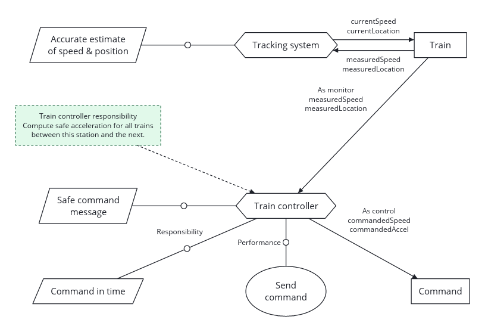

<div align="center" dir="rtl">
    
    <h1>Lamda RED</h1>
    <p>
        <a href="../en/README.md">English</a> ·
        <a href="../ru/README.md">Русский</a> ·
        <a href="../fa/README.md">فارسی</a> ·
        <a href="../ar/README.md">العربية</a> ·
        <a href="../tr/README.md">Türkçe</a> ·
        <a href="../zh-CN/README.md">简体中文</a> ·
        <a href="../de/README.md">Deutsch</a> ·
        <a href="../es/README.md">Español</a> ·
        <a href="../ko/README.md">한국어</a>
    </p>
    <p>نمودارهای مهندسی نیازمندی‌ها از متن ساده</p>
</div>

<div dir="rtl">

Lamda RED فایل‌های متنی `.zz` را به نمودارهای مهندسی نیازمندی‌ها تبدیل می‌کند. با آن نشان بدهید سیستم باید به چه هدف‌هایی برسد، چه ریسک‌هایی دارد و عامل‌ها و اشیای سیستم چگونه با هم ارتباط دارند. سورس نمودار را کنار نیازمندی‌ها در Git نگه دارید تا تیم بتواند تغییرات را در diff مرور کند و تصاویر را دوباره بسازد.

نمودار را با **Drizzle** بنویسید و با **`lmdred`** کامپایل کنید. کامپایلر یک PNG برای اسناد و یک فایل mxGraph XML قابل‌ویرایش برای diagrams.net (draw.io) می‌سازد. گزینهٔ `--export-set` سه نسخهٔ کم‌حجم، مناسب اسناد و وضوح بالا تولید می‌کند. افزونهٔ همراه در VS Code دسکتاپ پیش‌نمایش را کنار ادیتور نشان می‌دهد و با ذخیره یا دکمهٔ **Export diagram** خروجی می‌گیرد.

## از Drizzle تا نمودار

در این مثال، یک عامل مقدار یکی از اشیا را پایش و شیء دیگری را کنترل می‌کند. تصویر زیر نتیجهٔ رندر است.


این نمونه را با نام `object-agent.zz` ذخیره کنید.

<div dir="ltr">

```drizzle
Input = [Object (obj1)]
Monitor = <Agent (Ag)>
Output = [Object (obj2)]

Input __> Monitor : Obj1.attribute1\nValue monitoring
Monitor __> Output : Obj2.attribute2\nState variable\nControl
```

</div>

پس از نصب کامپایلر، دستور را در پوشهٔ همان فایل اجرا کنید تا `object-agent.png` و `object-agent.xml` ساخته شوند.

<div dir="ltr">

```sh
lmdred object-agent.zz object-agent
```

</div>

[نصب](#installation) · [پیش‌نمایش در VS Code](../../README.md#live-preview-in-vs-code) · [راهنمای سینتکس Drizzle](#drizzle-syntax)

- [استفاده از خط فرمان](#cli-usage)
- [سینتکس Drizzle](#drizzle-syntax)
- [افزونهٔ Drizzle برای VS Code](./vscode.md)
- [نصب](#installation)
- [سورس و توسعه](#source-and-development)
  - [آماده‌سازی سورس](#set-up-the-source)
  - [اجرا و اشکال‌زدایی](#run-and-debug)
  - [تست و بررسی](#test-and-check)
  - [ساخت و بسته‌بندی](#build-and-package)
  - [انتشار نسخهٔ کامپایلر](#publish-a-compiler-release)
- [راهنمای توسعه](../../DEVELOPER.md)
- [راهنمای مشارکت](../../CONTRIBUTING.md)
- [آیین‌نامهٔ رفتاری](../../CODE_OF_CONDUCT.md)
- [تاریخچهٔ تغییرات](./CHANGELOG.md)
- [نقشهٔ راه](#roadmap)
- [مجوز](#license)

<a name="cli-usage"></a>

## استفاده از خط فرمان

فرمان نصب‌شده را از هر دایرکتوری می‌توانید اجرا کنید.

<div dir="ltr">

```text
lmdred [input.zz] [output-stem]
lmdred --help
lmdred --version
```

</div>

| آرگومان یا گزینه | معنا | پیش‌فرض |
| --- | --- | --- |
| `input.zz` | مسیر فایل سورس UTF-8 در Drizzle | `sample.zz` در دایرکتوری جاری |
| `output-stem` | مسیر خروجی پیش از افزودن پسوندهای `.png` و `.xml` | `output` در دایرکتوری جاری |
| `-h`, `--help` | نمایش راهنمای خط فرمان |  |
| `-V`, `--version` | نمایش نسخهٔ کامپایلر، مانند `lmdred 1.2.0` |  |
| `--` | تفسیر آرگومان‌های باقی‌مانده به‌عنوان مسیر فایل |  |

<a name="output-paths"></a>

### مسیرهای خروجی

مسیرهای نسبی از دایرکتوری جاری ترمینال محاسبه می‌شوند. برای انتخاب محل دیگر مسیر مطلق بدهید. دایرکتوری مقصد باید از قبل وجود داشته باشد. کامپایلر پسوندها را به نام پایه اضافه می‌کند.

| دستور | فایل‌های تولیدشده نسبت به دایرکتوری جاری |
| --- | --- |
| `lmdred sample.zz my-new-red` | `my-new-red.png` و `my-new-red.xml` |
| `lmdred sample.zz` | `output.png` و `output.xml` |
| `lmdred` | `sample.zz` را می‌خواند و `output.png` و `output.xml` را می‌نویسد |
| `lmdred diagrams/train.zz` | `output.png` و `output.xml` |
| `lmdred diagrams/train.zz reports/train` | `reports/train.png` و `reports/train.xml` |
| `lmdred sample.zz train.v1` | `train.v1.png` و `train.v1.xml` |

مسیرهای دارای فاصله را داخل گیومه بگذارید. اگر مسیر با `-` شروع می‌شود، ابتدا `--` را بنویسید.

<div dir="ltr">

```sh
lmdred "my diagrams/train.zz" "my diagrams/train"
lmdred -- "-file.zz" result
```

</div>

<a name="output-formats-and-errors"></a>

### قالب‌های خروجی و خطاها

بوم PNG طوری اندازه‌گذاری می‌شود که شکل‌ها، ارتباط‌ها و برچسب‌ها جا شوند. فایل mxGraph XML شامل شکل‌ها، ارتباط‌ها و نقاط مسیر قابل‌ویرایش در diagrams.net/draw.io است.

کامپایل موفق هر دو مسیر را چاپ می‌کند و با وضعیت `0` پایان می‌یابد. در صورت خطا، پیام در خروجی خطای استاندارد چاپ می‌شود و وضعیت `1` برمی‌گردد. خطاهای نحوی و ارجاعی نام فایل، سطر و ستون را دارند.

ذخیرهٔ موفق فایل‌های خروجی موجود را بازنویسی می‌کند. کامپایلر بررسی می‌کند که هیچ مسیر خروجی جای فایل سورس را نگیرد. تجزیه و رندر پیش از نوشتن خروجی‌ها انجام می‌شود. خطای ذخیره ممکن است یکی از دو خروجی را باقی بگذارد. پیام را بررسی و پس از اصلاح مسیر یا مجوزها دوباره اجرا کنید.

<a name="drizzle-syntax"></a>

## سینتکس Drizzle

PNG را در اسناد و ارائه‌ها به‌کار ببرید و فایل Drizzle را در کنار نیازمندی‌ها نگه دارید تا بازبین‌ها بتوانند هدف‌ها، ریسک‌ها، عامل‌ها و روابط را دنبال و ویرایش کنند. هر کامپایل فایل قابل‌ویرایش mxGraph XML هم می‌سازد.

<a name="a-first-diagram"></a>

### اولین نمودار

نمونه را با نام `first.zz` ذخیره کنید و `lmdred first.zz first` را اجرا کنید.

<div dir="ltr">

```drizzle
&& The tracking agent reports train speed and location.
Tracking = <Tracking system>
Train = [Train]
Tracking __> Train : currentSpeed\ncurrentLocation
```

</div>

خروجی عامل شش‌ضلعی، شیء مستطیلی و فلش پیوسته به سمت قطار دارد. برچسب بالای فلش دو سطر دارد.

<a name="declare-nodes"></a>

### تعریف گره‌ها

با `ID = shape` گرهی تعریف کنید که در ارتباط‌ها قابل ارجاع باشد. شناسه به بزرگی و کوچکی حروف حساس است، با حرف ASCII شروع می‌شود و می‌تواند حروف، ارقام و زیرخط تکی بین حروف یا ارقام داشته باشد. `Train_1` یک شناسه است. متن داخل شکل برچسب نمایشی است. ارتباط می‌تواند پیش یا پس از تعریف گره بیاید. برای توضیح در ابتدای سطر `&&` بنویسید. سطر خالی و تورفتگی مجازند.

شکل به‌تنهایی هم قابل تعریف است، مانند `/Safe journey/`. برای استفاده از شکل در ارتباط به آن شناسه بدهید.

| شکل | تعریف | نتیجه |
| --- | --- | --- |
| هدف | `G = /Safe journey/` | متوازی‌الاضلاع مایل به راست |
| ریسک | `R = \Signal lost\` | متوازی‌الاضلاع معکوس |
| عامل | `A = <Train controller>` | شش‌ضلعی |
| گزارهٔ توصیفی | `D = ~Doors are locked in motion~` | ذوزنقه با قاعدهٔ پهن‌تر |
| شیء | `O = [Train]` | مستطیل |
| کنش | `Send = (Send command)` | بیضی |
| یادداشت | `N = {Controller responsibility}` | مستطیل سبز روشن با حاشیهٔ خط‌چین |
| توضیح ابری | `C = {{Reason for the obstacle}}` | حاشیه به‌شکل ابر |
| لوزی | `Check = ^Speed confirmed?^` | لوزی |

پیشوند `!` حاشیهٔ شکل را ضخیم می‌کند. در نشانه‌گذاری مرجع، برگ‌هایی مثل نیازمندی و فرض با این حالت مشخص می‌شوند. ضخامت متن برچسب عادی می‌ماند.

<div dir="ltr">

```drizzle
/Goal/
!/Leaf requirement/
~Descriptive~
<Agent 1>
```

</div>

<a name="labels-and-line-breaks"></a>

#### برچسب‌ها و شکست سطر

برچسب‌ها UTF-8 و متن راست‌به‌چپ را می‌پذیرند. رندرکننده اندازهٔ متن را می‌سنجد، آن را وسط‌چین می‌کند و اندازهٔ شکل را تنظیم می‌کند. متن بلند تا حد امکان بین کلمه‌ها می‌شکند. کلمهٔ بلند ممکن است از وسط بشکند. برچسب شکل تا چهار سطر و برچسب ارتباط تا سه سطر نمایش داده می‌شود. متن اضافی با `...` مشخص می‌شود. برچسب کامل در سورس می‌ماند.

| سینتکس | نتیجه |
| --- | --- |
| `/Accurate estimate\nof speed and position/` | برچسب هدف با شکست سطر |
| `[C:\\Logs]` | مستطیل با برچسب `C:\Logs` |
| `<Speed \> zero>` | عامل با برچسب `Speed > zero` |
| `/Input \/ output/` | هدف با برچسب `Input / output` |
| `~Value \~ threshold~` | ذوزنقه با برچسب `Value ~ threshold` |

برای شکست سطر اجباری `\n` و برای نمایش بک‌اسلش `\\` بنویسید. برای نمایش جداکننده در برچسب، قبل از آن بک‌اسلش بگذارید.

<a name="connect-nodes"></a>

### اتصال گره‌ها

دو طرف عملگر، شناسهٔ گره‌ها را بنویسید. دو نویسهٔ وسط نوع خط را تعیین می‌کنند. `<` و `>` به‌ترتیب نوک فلش در سمت چپ و راست اضافه می‌کنند. برای خوانایی می‌توانید میان شناسه و عملگر فاصله بگذارید.

| جهت | پیوسته | خط‌چین |
| --- | --- | --- |
| بدون نوک فلش | `A __ B` | `A -- B` |
| به سمت B | `A__>B` | `A-->B` |
| به سمت A | `A<__B` | `A<--B` |
| به هر دو سمت | `A<__>B` | `A<-->B` |

برای نوشتن برچسب، پس از ارتباط و گزینه‌هایش دونقطه بگذارید. دو ارتباط بین یک جفت گره می‌توانند برچسب و مسیر جدا داشته باشند. ارتباط کاملاً تکراری یک‌بار رسم می‌شود. اتصال گره به خودش حلقه می‌سازد.

<div dir="ltr">

```drizzle
Tracking = <Tracking system>
Train = [Train]
Tracking __> Train : currentSpeed\ncurrentLocation
Tracking <__ Train : measuredSpeed\nmeasuredLocation
Train --> Train : Refresh state
```

</div>

<a name="add-notation-to-a-connection"></a>

#### افزودن نشانگر ارتباط

| گزینه | نمونه | نتیجه |
| --- | --- | --- |
| `[o]` | `A __ B [o]` | دایرهٔ توخالی روی خط |
| `[*]` | `A __> B [*]` | دایرهٔ توپر روی خط |
| `[zigzag]` | `A __ B [zigzag]` | زیگزاگ برای تضاد |
| `[bar]` | `Risk --> Goal [bar]` | خط عرضی برای مانع |
| `[ortho]` | `A __> B [ortho]` | مسیر متشکل از پاره‌خط‌های افقی و عمودی |

در هر ارتباط یک دایره، زیگزاگ یا خط عرضی به‌کار ببرید. نشانگر با `[ortho]` و هر دو نوع خط قابل ترکیب است. خط عرضی در ارتباط تک‌فلش نزدیک نوک فلش و در ارتباط بی‌فلش یا دوطرفه نزدیک وسط مسیر است.

<a name="join-several-sources"></a>

#### ادغام چند مبدأ

ارتباط‌های رو به مقصد مشترک، اگر نوع خط، نشانگر، برچسب و گزینه‌های مسیرشان یکسان باشد، قطعهٔ انتهایی مشترک دارند. مسیرهای دورزن صریح جدا می‌مانند. برای تعریف مستقیم شاخهٔ مشترک، شناسهٔ مبدأها را با ویرگول جدا کنید. دایرهٔ توپر یا توخالی روی محل انشعاب قرار می‌گیرد، فلش راست وارد مقصد می‌شود و فلش چپ در شاخهٔ صریح به هر مبدأ اشاره می‌کند.

<div dir="ltr">

```drizzle
layout up
Goal @1,0 = /Safe departure/
Software @0,1 = !/Verify the lock signal/
Assumption @2,1 = !/The door sensor works/

Software, Assumption __> Goal [o]
```

</div>

دو گرهٔ برگ در یک خط مشترک با دایرهٔ توخالی و یک فلش به سمت هدف بالایی به‌هم می‌پیوندند. نوشتن `Software __> Goal [o]` و `Assumption __> Goal [o]` در سطرهای جدا همان نتیجه را دارد.

<a name="set-the-layout-and-routing"></a>

### چیدمان و مسیریابی

| کنترل | نمونه | نتیجه |
| --- | --- | --- |
| جهت | `layout right` | جریان خودکار از چپ به راست، حالت پیش‌فرض |
| جهت | `layout left` | جریان خودکار از راست به چپ |
| جهت | `layout up` | جریان خودکار از پایین به بالا با مسیرهای قائم‌زاویه |
| جهت | `layout down` | جریان خودکار از بالا به پایین با مسیرهای قائم‌زاویه |
| جای‌گذاری شبکه | `Goal @2,0 = /Goal/` | شکل در ستون ۲، سطر ۰ قرار می‌گیرد |
| مسیر بیرونی | `A --> B [bar] via bottom` | ارتباط از پایین نمودار دور می‌زند |

در هر نمودار حداکثر یک دستور چیدمان بنویسید. مختصات شبکه از صفر آغاز می‌شوند. ستون‌ها به راست و سطرها به پایین زیاد می‌شوند. هر خانهٔ صریح فقط یک گره می‌گیرد. اندازهٔ سطرها و ستون‌ها با شکل‌ها تنظیم می‌شود و بوم PNG کل نمودار را می‌پوشاند. جای‌گذاری خودکار و صریح را می‌توان ترکیب کرد.

تصویر زیر نمونهٔ شیء و عامل را در سطر صفر نشان می‌دهد. خط‌چین‌ها و نقطه‌های تقاطع، مختصات شبکه را مشخص می‌کنند. تقاطع برجستهٔ `@0,2` ستون صفر و سطر دو است.


<div dir="ltr">

```drizzle
Input @0,0 = [Object (obj1)]
Monitor @1,0 = <Agent (Ag)>
Output @2,0 = [Object (obj2)]

Input __> Monitor : Obj1.attribute1\nValue monitoring
Monitor __> Output : Obj2.attribute2\nState variable\nControl
```

</div>

برای گذاشتن یادداشت در تقاطع برجسته، `Explanation @0,2 = {Column zero, row two}` را اضافه کنید. مختصات یک خانه را تعیین می‌کند و موقعیت پیکسلی به اندازهٔ شکل‌ها بستگی دارد.

پس از گزینه‌های ارتباط و پیش از برچسب، `via right`، `via left`، `via top` یا `via bottom` بنویسید. به این ترتیب مسیر تضاد یا مانع می‌تواند ارتباط‌های دیگر را دور بزند.

<div dir="ltr">

```drizzle
layout up
Login @0,0 = /User can sign in/
Blocked @0,1 = \User cannot sign in\
Recover @0,2 = /Recover using a phone number/

Recover __> Blocked
Blocked __> Login
Recover __> Login [zigzag] via right : A non-user might gain access
```

</div>

دو ارتباط اول رو به بالای درخت‌اند. تضاد از سمت راست دور می‌زند و به هدف برمی‌گردد.

<a name="reference-diagrams"></a>

### نمودارهای مرجع

هر تصویر نتیجهٔ کامپایل فایل Drizzle پیوندشده است. برای نمودار دِ مورگان، `lmdred sample/de-morgan.zz de-morgan` را اجرا کنید یا مسیر نمونه و نام پایهٔ خروجی دیگری بدهید.

<a name="goal-notation-and-obstacles"></a>

#### نشانه‌گذاری هدف و موانع

حاشیهٔ ضخیم گرهٔ برگ را مشخص می‌کند. ذوزنقه گزاره‌ای توصیفی را ثبت می‌کند و شکل معکوس ریسک با خط عرضی مانع به هدف اشاره می‌کند. توضیح در ابر قرار دارد. [سورس Drizzle](../../sample/notation.zz).


<a name="requirement-refinement"></a>

#### پالایش نیازمندی‌ها

ارتباط‌های مستقل به نیازمندی پالایش‌شده و برگ‌ها اجازه می‌دهند نشانگر و فلش جداگانه داشته باشند. [سورس Drizzle](../../sample/requirements.zz).


<a name="rail-goal-conflicts"></a>

#### تضاد هدف‌های راه‌آهن

شاخه‌ها چند پالایش را در یک محل به هم وصل می‌کنند. زیگزاگ‌ها هدف‌های متضاد را در درخت متصل می‌کنند. [سورس Drizzle](../../sample/rail-conflicts.zz).


<a name="authentication-risk"></a>

#### ریسک احراز هویت

شکل‌های معکوس مشکلات ورود را نشان می‌دهند. زیگزاگ بیرونی تضاد احتمالی ناشی از یک گزینهٔ بازیابی را نمایش می‌دهد. [سورس Drizzle](../../sample/auth-risk.zz).


<a name="de-morgan-goal-and-risk-diagram"></a>

#### نمودار هدف و ریسک دِ مورگان

سورس، هدف و نقیض آن، شاخهٔ مشترک پالایش و سه مانع خط‌چین را صریح تعریف می‌کند. [سورس Drizzle](../../sample/de-morgan.zz).


<a name="agent-monitoring-and-control"></a>

#### پایش و کنترل عامل

عامل شش‌ضلعی ویژگی شیء اول را دریافت می‌کند و ویژگی شیء دوم را کنترل می‌کند. [سورس Drizzle](../../sample/object-agent.zz).


<a name="train-control"></a>

#### کنترل قطار

خط‌های پیوسته و خط‌چین، فلش‌های جدا برای اندازه‌گیری و فرمان، بیضی کنش و یادداشت مسئولیت در یک نمودار آمده‌اند. [سورس Drizzle](../../sample.zz).



<a name="editor-and-diagnostics"></a>

### ویرایشگر و تشخیص خطا

افزونهٔ VS Code در `drizzle/` فایل‌های `.zz`، `.drizzle` و `.rd` را رنگ‌آمیزی می‌کند. برای امتحان دستور زبان فعلی، پوشه را در VS Code باز کنید و **F5** را بزنید تا Extension Development Host اجرا شود. سورس نمودار را در پنجرهٔ میزبان باز کنید. [مستندات افزونهٔ VS Code](https://code.visualstudio.com/api/get-started/your-first-extension).

| پیام یا نشانه | روش رفع |
| --- | --- |
| `unknown node 'X'` | گره `X` را با همان بزرگی و کوچکی حروف تعریف کنید یا ارجاع را اصلاح کنید. |
| `duplicate ID` | به هر گرهٔ تعریف‌شده شناسهٔ یکتا بدهید. |
| `cell @… is already occupied` | یکی از گره‌ها را در خانهٔ دیگری بگذارید. |
| `invalid Drizzle syntax` | با نام فایل، شمارهٔ سطر و ستون، جداکننده، عملگر یا گزینهٔ نابجا را پیدا کنید. |
| `diagram is too large for PNG output` | خانه‌های دور از هم را نزدیک‌تر کنید یا مدل را به چند نمودار تقسیم کنید. |
| `no system fonts found` | فونت بدون سریف نصب و کامپایلر را دوباره اجرا کنید. |
| `link.exe not found` | ابزار ساخت MSVC را نصب کنید یا دستور GNU را اجرا کنید. |

<a name="installation"></a>

## نصب

دستورهای زیر پس از بارگذاری فایل‌ها، ریلیز کامپایلر `lmdred-v1.2.0` را دانلود می‌کنند.

نصب‌کننده‌ها معماری x64 یا ARM64 را تشخیص می‌دهند، آرشیو و چک‌سام SHA-256 آن را دانلود و اعتبارسنجی می‌کنند و `lmdred` را در حساب کاربری نصب می‌کنند. برای ارتقا یا تعمیر نصب، نصب‌کننده را دوباره اجرا کنید.

<a name="linux-and-macos"></a>

### لینوکس و macOS

نصب‌کننده را با curl دانلود و اجرا کنید.

<div dir="ltr">

```sh
curl -fL https://github.com/Asncodes-80/lamda_red/releases/download/lmdred-v1.2.0/install.sh -o install-lmdred.sh
sh install-lmdred.sh
```

</div>

دانلود با wget هم ممکن است.

<div dir="ltr">

```sh
wget https://github.com/Asncodes-80/lamda_red/releases/download/lmdred-v1.2.0/install.sh -O install-lmdred.sh
sh install-lmdred.sh
```

</div>

مسیر پیش‌فرض `$HOME/.local/bin` است. نصب‌کننده `~/.profile` و فایل‌های راه‌اندازی پوستهٔ فعال Bash، Zsh یا Fish را به‌روز می‌کند. پس از نصب ترمینال جدیدی باز کنید. در Bash، Zsh یا sh می‌توانید دستور را در ترمینال فعلی هم فعال کنید.

<div dir="ltr">

```sh
export PATH="$HOME/.local/bin:$PATH"
lmdred --version
```

</div>

با گزینه‌های زیر نسخه یا مسیر نصب را تعیین کنید.

<div dir="ltr">

```sh
sh install-lmdred.sh --version 1.2.0 --bin-dir "$HOME/.local/bin"
sh install-lmdred.sh --no-modify-path
```

</div>

متغیرهای محیطی `LMDRED_VERSION` و `LMDRED_INSTALL_DIR` مقدار پیش‌فرض را تعیین می‌کنند. گزینه‌های صریح خط فرمان اولویت دارند. در پوسته‌های دیگر مسیر نصب را به تنظیمات راه‌اندازی اضافه کنید.

<a name="windows"></a>

### ویندوز

نصب‌کننده را در PowerShell دانلود و اجرا کنید.

<div dir="ltr">

```powershell
$installer = Join-Path $env:TEMP 'install-lmdred.ps1'
Invoke-WebRequest -Uri 'https://github.com/Asncodes-80/lamda_red/releases/download/lmdred-v1.2.0/install.ps1' -OutFile $installer
powershell -NoProfile -ExecutionPolicy Bypass -File $installer
```

</div>

ترمینال جدیدی باز کنید و `lmdred --version` را اجرا کنید. نصب‌کننده فایل اجرایی را در `%LOCALAPPDATA%\Programs\lmdred\bin` می‌گذارد و مسیر را به ابتدای PATH کاربر می‌برد تا بر نسخهٔ نصب‌شده با Cargo اولویت داشته باشد. اگر نسخهٔ نصب‌شده در سطح سیستم اولویت داشته باشد، نصب‌کننده مسیرش را گزارش می‌کند. با `Get-Command lmdred -All` می‌توانید نسخهٔ انتخاب‌شده را بررسی کنید.

با این گزینه‌ها مسیر دیگری انتخاب کنید یا PATH را خودتان مدیریت کنید.

<div dir="ltr">

```powershell
powershell -NoProfile -ExecutionPolicy Bypass -File $installer -Version 1.2.0 -InstallDirectory "$env:LOCALAPPDATA\Programs\lmdred\bin"
powershell -NoProfile -ExecutionPolicy Bypass -File $installer -NoModifyPath
```

</div>

متغیرهای `LMDRED_VERSION` و `LMDRED_INSTALL_DIR` در ویندوز هم پیش‌فرض‌ها را تعیین می‌کنند.

<a name="download-an-archive-directly"></a>

### دانلود مستقیم آرشیو

آرشیو مناسب سیستم را باز کنید و فایل اجرایی را در یکی از مسیرهای PATH بگذارید.

| سیستم | پردازنده | آرشیو انتشار |
| --- | --- | --- |
| Windows | x64 | `lmdred-v1.2.0-x86_64-pc-windows-msvc.zip` |
| Windows | ARM64 | `lmdred-v1.2.0-aarch64-pc-windows-msvc.zip` |
| macOS | Intel | `lmdred-v1.2.0-x86_64-apple-darwin.tar.gz` |
| macOS | Apple Silicon | `lmdred-v1.2.0-aarch64-apple-darwin.tar.gz` |
| Linux | x64 | `lmdred-v1.2.0-x86_64-unknown-linux-musl.tar.gz` |
| Linux | ARM64 | `lmdred-v1.2.0-aarch64-unknown-linux-musl.tar.gz` |

فایل‌های انتشار لینوکس از musl استفاده می‌کنند و در توزیع‌های glibc و musl اجرا می‌شوند. بیلد ویندوز به‌صورت ایستا به کتابخانهٔ زمان اجرای C پیوند می‌خورد. رندر از فونت‌های سیستم استفاده می‌کند. روی سرور یا کانتینر حداقلی لینوکس فونتی بدون سریف مانند DejaVu Sans نصب کنید.

<a name="install-from-source"></a>

### نصب از سورس

پس از نصب Rust و ابزارهای ساخت سیستم، دستور زیر را از ریشهٔ مخزن اجرا کنید.

<div dir="ltr">

```sh
cargo install --path . --locked
```

</div>

Cargo فرمان `lmdred` را در `~/.cargo/bin` و در ویندوز در `%USERPROFILE%\.cargo\bin` نصب می‌کند. در صورت نیاز آن مسیر را به PATH اضافه کنید. نصب مستقیم از سورس GitHub هم ممکن است.

<div dir="ltr">

```sh
cargo install --git https://github.com/Asncodes-80/lamda_red --locked --bin lmdred
```

</div>

برای ابزارهای GNU در ویندوز از این دستور استفاده کنید.

<div dir="ltr">

```powershell
cargo +stable-x86_64-pc-windows-gnu install --path . --locked
```

</div>

<a name="source-and-development"></a>

## سورس و توسعه

کامپایلر فایل سورس UTF-8 را می‌خواند، گره‌ها و ارتباط‌ها را استخراج می‌کند، اندازهٔ برچسب‌ها را می‌سنجد، چیدمان و مسیرها را محاسبه می‌کند و خروجی می‌گیرد.

| مسیر | مسئولیت |
| --- | --- |
| [src/main.rs](../../src/main.rs) | آرگومان‌های خط فرمان، مسیر فایل‌ها، خطاها و مراحل کامپایل |
| [src/lamda_red_grammar.pest](../../src/lamda_red_grammar.pest) | دستور زبان Drizzle |
| [src/parsing.rs](../../src/parsing.rs) | مدل نمودار، تعریف‌ها، ارجاع‌ها و خطاهای نحوی |
| [src/labels.rs](../../src/labels.rs) | یافتن فونت، شکل‌دهی متن، شکستن سطر و کوتاه کردن متن |
| [src/layout.rs](../../src/layout.rs) | هندسهٔ شکل‌ها، جای‌گذاری در شبکه و محدودهٔ بوم |
| [src/routing.rs](../../src/routing.rs) | ارتباط‌ها، شاخه‌ها، مسیرهای دورزن و موقعیت برچسب ارتباط‌ها |
| [src/export.rs](../../src/export.rs) | تولید PNG و mxGraph XML |
| [sample.zz](../../sample.zz) و [sample/](../../sample/) | کنترل قطار و سایر نمودارهای مرجع |
| [tests/test_cli_install.py](../../tests/test_cli_install.py) | آزمون یکپارچهٔ خط فرمان و نصب‌کننده‌های انتشار |
| [scripts/](../../scripts/) | نصب‌کننده‌ها و ساخت آرشیو انتشار |
| [.github/workflows/release-cli.yml](../../.github/workflows/release-cli.yml) | ساخت، آزمون و انتشار برای شش هدف |
| [drizzle/](../../drizzle/) | افزونهٔ رنگ‌آمیزی سینتکس VS Code |

<a name="set-up-the-source"></a>

### آماده‌سازی سورس

نسخه‌ای جدید و پایدار از ابزارهای Rust، برنامهٔ Cargo و ابزارهای ساخت سیستم را نصب کنید. آزمون یکپارچهٔ خط فرمان و نصب‌کننده‌ها به Python 3 نیاز دارد. بسته‌بندی انتشار در Windows PowerShell 5.1 یا PowerShell 7 اجرا می‌شود. خروجی PNG از فونت‌های سیستم استفاده می‌کند. [نصب Rust](https://www.rust-lang.org/tools/install).

<div dir="ltr">

```sh
git clone https://github.com/Asncodes-80/lamda_red.git
cd lamda_red
cargo build --locked
```

</div>

در ویندوز، ساخت با MSVC به ابزارهای ساخت C++ ویژوال استودیو نیاز دارد. در macOS ابزارهای خط فرمان Xcode را نصب کنید. در لینوکس کامپایلر C و لینک‌کننده را نصب کنید. در محیط‌های حداقلی لینوکس فونتی مانند DejaVu Sans هم لازم است.

برای ابزارهای GNU در ویندوز از دستورهای زیر استفاده کنید. در دستورهای دیگر ساخت، اجرا، تست و نصب این راهنما نیز می‌توانید `+stable-x86_64-pc-windows-gnu` را بلافاصله بعد از `cargo` بگذارید.

<div dir="ltr">

```powershell
rustup toolchain install stable-x86_64-pc-windows-gnu --profile minimal --component clippy,rustfmt
cargo +stable-x86_64-pc-windows-gnu build --locked
```

</div>

فایل `Cargo.lock` را در مخزن نگه دارید و با `--locked` از نسخه‌های ثبت‌شدهٔ وابستگی‌ها استفاده کنید.

<a name="run-and-debug"></a>

### اجرا و اشکال‌زدایی

بیلد توسعهٔ Cargo اطلاعات اشکال‌زدایی دارد. دستور زیر یکی از نمودارهای مرجع را کامپایل می‌کند.

<div dir="ltr">

```sh
cargo run --locked -- sample/requirements.zz target/requirements
cargo run --locked -- --help
cargo run --locked -- --version
```

</div>

دستور اول فایل‌های `target/requirements.png` و `target/requirements.xml` را می‌سازد. اجرای `cargo run --locked` بدون آرگومان، `sample.zz` را می‌خواند و `output.png` و `output.xml` را در ریشهٔ مخزن می‌نویسد.

برای اشکال‌زدایی در VS Code، ریشهٔ مخزن را باز کنید، CodeLLDB را نصب کنید و تنظیمات زیر را به `.vscode/launch.json` اضافه کنید. این تنظیمات `lmdred` را با Cargo می‌سازد و نمونه را با مسیرهای نسبی به ریشهٔ مخزن باز می‌کند. [مرجع تنظیمات CodeLLDB](https://github.com/vadimcn/codelldb/blob/master/MANUAL.md#cargo-support).

<div dir="ltr">

```json
{
  "version": "0.2.0",
  "configurations": [
    {
      "name": "Debug lmdred",
      "type": "lldb",
      "request": "launch",
      "cargo": {
        "args": ["build", "--locked", "--bin", "lmdred"],
        "filter": { "name": "lmdred", "kind": "bin" }
      },
      "args": ["sample/requirements.zz", "target/debug-diagram"],
      "cwd": "${workspaceFolder}",
      "env": { "RUST_BACKTRACE": "1" },
      "sourceLanguages": ["rust"]
    }
  ]
}
```

</div>

در تابع `run` در `src/main.rs` نقطهٔ توقف بگذارید و **F5** را بزنید. برای بررسی مدل وارد `parsing::parse` شوید، برای موقعیت‌ها و مسیرها وارد `layout::arrange` و برای خروجی وارد `export::png` یا `export::xml` شوید. برای انتخاب صریح GNU در تنظیمات اشکال‌زدایی، آرگومان‌های Cargo را به `["+stable-x86_64-pc-windows-gnu", "build", "--locked", "--bin", "lmdred"]` تغییر دهید.

<a name="test-and-check"></a>

### تست و بررسی

تست‌ها، قالب‌بند و لینتر Rust را از ریشهٔ مخزن اجرا کنید.

<div dir="ltr">

```sh
cargo test --locked
cargo fmt --check
cargo clippy --locked --all-targets -- -D warnings
```

</div>

تست‌های Rust تجزیه و ارجاع‌ها، نشانگرها و شاخه‌ها، سازگاری با نسخه‌های قبل، مسیریابی دور موانع و شکستن و کوتاه کردن متن را پوشش می‌دهند.

برای بررسی خط فرمان و نصب‌کننده‌ها، فایل اجرایی انتشار را بسازید و مسیرش را به تست یکپارچه بدهید.

<div dir="ltr">

```sh
cargo build --locked --release
python tests/test_cli_install.py --binary target/release/lmdred
```

</div>

در ویندوز از `target/release/lmdred.exe` استفاده کنید. اگر هدف Rust را صریح تعیین کرده‌اید، از `target/<target>/release/lmdred` یا `lmdred.exe` استفاده کنید. تست یکپارچه از بیرون مخزن خروجی می‌گیرد، مسیرهای دارای فاصله و پیش‌فرض‌های خروجی را بررسی می‌کند و آرشیو را از HTTP محلی ارائه می‌دهد. نصب و نصب مجدد در مسیر موقت انجام می‌شود و تست بررسی می‌کند که چک‌سام خراب رد شود و فایل نصب‌شده محفوظ بماند.

<a name="build-and-package"></a>

### ساخت و بسته‌بندی

<div dir="ltr">

```sh
cargo build --locked
cargo build --locked --release
```

</div>

فایل‌های توسعه در `target/debug/` و فایل‌های بهینه‌شده در `target/release/` ساخته می‌شوند. نام فایل اجرایی در لینوکس و macOS برابر `lmdred` و در ویندوز برابر `lmdred.exe` است.

در ویندوز ابتدا هدف را بسازید، سپس آن را با Windows PowerShell 5.1 بسته‌بندی کنید. برای PowerShell 7 از `pwsh` به‌جای `powershell.exe` استفاده کنید.

<div dir="ltr">

```powershell
$compilerTarget = ((rustc -vV | Select-String '^host: ').Line -split ': ', 2)[1]
cargo build --locked --release --target $compilerTarget
powershell.exe -NoProfile -ExecutionPolicy Bypass -File .\scripts\package-release.ps1 -Target $compilerTarget
```

</div>

هر دو مرحله از هدف ابزار فعال Rust استفاده می‌کنند. در ویندوز x64، هدف `x86_64-pc-windows-msvc` یا `x86_64-pc-windows-gnu` است. فایل اجرایی در `target/<target>/release/` قرار می‌گیرد. آرشیو و فایل `.sha256` آن در `target/dist/` ذخیره می‌شوند. هر آرشیو فایل اجرایی، مجوز، README و `sample.zz` را دارد. هدف‌های یونیکس از آرشیو `.tar.gz` استفاده می‌کنند.

<a name="publish-a-compiler-release"></a>

### انتشار نسخهٔ کامپایلر

گردش کار انتشار، فایل‌های اجرایی بومی x64 و ARM64 را برای ویندوز، macOS و لینوکس می‌سازد و می‌آزماید. آرشیوها، چک‌سام‌های SHA-256، هر دو نصب‌کننده و فایل تجمیعی `SHA256SUMS` بارگذاری می‌شوند.

1. گردش کار **Version Bump** را از زبانهٔ **Actions** ([`.github/workflows/version-bump.yml`](../../.github/workflows/version-bump.yml)) اجرا کنید و `patch`، `minor` یا `major` را برگزینید. این گردش کار یک Pull Request باز می‌کند که `Cargo.toml` را به‌روزرسانی، `Cargo.lock` را همگام‌سازی، `CHANGELOG.md` را به‌روز و نسخهٔ پیش‌فرض `scripts/install.sh` و `scripts/install.ps1` و نشانی‌های دانلود و دستورهای نصب نسخه‌دار در این README و [ترجمه‌های آن](../) را به‌روز می‌کند. تنظیمات مخزن باید به GitHub Actions اجازهٔ ساخت Pull Request بدهد.
2. Pull Request تغییر نسخه را بررسی و در `main` ادغام کنید. تگ‌گذاری در گردش کار تغییر نسخه به‌عمد غیرفعال شده تا تگ انتشار تنها پس از ادغام در `main` ساخته شود.
3. پس از ادغام، شاخهٔ `main` را دریافت کنید و تگ `lmdred-v<version>` را روی کامیت ادغام‌شده (مطابق با `Cargo.toml`) بسازید و پوش کنید:

<div dir="ltr">

```sh
git switch main
git pull origin main
git tag lmdred-v1.2.0
git push origin lmdred-v1.2.0
```

</div>

پوش کردن این تگ گردش کار [`.github/workflows/release-cli.yml`](../../.github/workflows/release-cli.yml) را آغاز می‌کند که تطابق تگ با `Cargo.toml` و هر دو نصب‌کننده را بررسی کرده و پس از موفقیت همهٔ بیلدها، ریلیز کامپایلر را می‌سازد. انتشار دستی ریلیز GitHub با همان تگ هم گردش کار را آغاز و فایل‌ها را به ریلیز پیوست می‌کند. دکمهٔ **Run workflow** برای شاخهٔ انتخاب‌شده فایل‌های قابل دانلود Actions را می‌سازد.

اگر به‌جای **Version Bump** نسخه را دستی آماده می‌کنید، پیش از پوش تگ مطابق، `Cargo.toml`، `Cargo.lock`، `CHANGELOG.md`، نسخهٔ پیش‌فرض هر دو نصب‌کننده و دستورهای نصب نسخه‌دار در READMEها را به‌روز کنید. پیشوند تگ کامپایلر `lmdred-v` است. افزونهٔ VS Code تگ‌های `drizzle-` و شمارهٔ نسخهٔ مستقلش را در `drizzle/package.json` دارد.

<a name="roadmap"></a>

## نقشهٔ راه

- ساخت نمودار ماشین حالت برای دستور زبان Pest پروژهٔ Lamda RED.
- ساخت سرویس وب با رابط React که PNG را از سرور Rust درخواست کند.

<a name="license"></a>

## مجوز

این پروژه تحت مجوز [GNU GPLv3](../../LICENSE) منتشر شده است.

</div>
