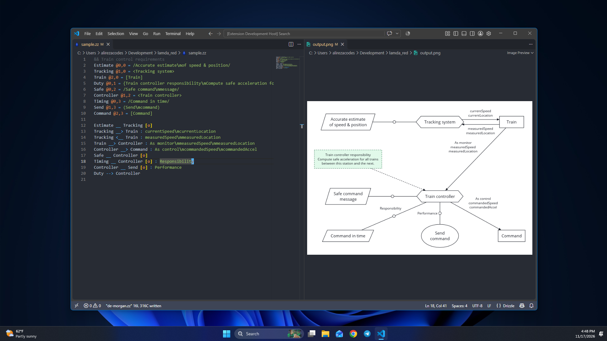

<div dir="rtl">

# افزونهٔ Drizzle برای VS Code

افزونهٔ Drizzle سینتکس فایل‌های `.zz`، `.drizzle` و `.rd` را در VS Code رنگ‌آمیزی می‌کند.


## نمایش افزونه



## نمونهٔ کنترل قطار

<div dir="ltr">

```drizzle
&& Train control requirements
Estimate @0,0 = /Accurate estimate\nof speed & position/
Tracking @1,0 = <Tracking system>
Train @2,0 = [Train]
Duty @0,1 = {Train controller responsibility\nCompute safe acceleration for all trains between this station and the next.}
Safe @0,2 = /Safe command\nmessage/
Controller @1,2 = <Train controller>
Timing @0,3 = /Command in time/
Send @1,3 = (Send\ncommand)
Command @2,3 = [Command]

Estimate __ Tracking [o]
Tracking __> Train : currentSpeed\ncurrentLocation
Tracking <__ Train : measuredSpeed\nmeasuredLocation
Train __> Controller : As monitor\nmeasuredSpeed\nmeasuredLocation
Controller __> Command : As control\ncommandedSpeed\ncommandedAccel
Safe __ Controller [o]
Timing __ Controller [o] : Responsibility
Controller __ Send [o] : Performance
Duty --> Controller
```

</div>

## خروجی کامپایلر


برای شناخت شکل‌ها، نشانگرهای ارتباط و کنترل چیدمان به [راهنمای سینتکس Drizzle](./README.md#drizzle-syntax) مراجعه کنید.

## توسعه و آزمایش افزونه

پوشهٔ `drizzle/` را در VS Code باز کنید. فایل `package.json` افزونه و مسیر دستور زبان را تعریف می‌کند. فایل `syntaxes/drizzle.tmLanguage.json` دستور زبان TextMate را دارد و `language-configuration.json` نشانه‌های توضیح و جفت پرانتزها را مشخص می‌کند.

**F5** را بزنید تا پنجرهٔ Extension Development Host باز شود. فایل نمونه را در آن باز کنید و رنگ‌آمیزی و تنظیمات زبان را بررسی کنید. پس از تغییر سورس، میزبان را دوباره اجرا کنید یا پنجره‌اش را بازخوانی کنید.

برای استفاده، افزونه را از Marketplace نصب کنید یا یک بستهٔ VSIX را با دستور **Extensions: Install from VSIX...** در VS Code نصب کنید. برای اطلاعات توسعه و انتشار، [مستندات افزونه‌های VS Code](https://code.visualstudio.com/api) را ببینید.

## تاریخچهٔ انتشار افزونه

### 1.1.3

- اصلاح نشانی تصاویر Marketplace برای لوگو، نمایش سینتکس و خروجی رندرشده.
- پیوند مستقیم به راهنمای کامل Drizzle در README مخزن.

### 1.1.0 – 1.1.2

- گسترش دستور زبان Pest با گره‌های نام‌دار، ارجاع به تعریف‌های بعدی، برچسب UTF-8، نویسه‌های گریز، شکست سطر و خطاهای دارای سطر و ستون. تعریف‌های بی‌نام هدف، ریسک و عامل و توضیحات تمام‌سطر حفظ شدند.
- افزودن اشیا، کنش‌ها، یادداشت‌ها، توضیحات ابری، ذوزنقه و لوزی و پشتیبانی از حاشیهٔ ضخیم برای گره‌های برگ مانند نیازمندی‌ها و فرض‌ها.
- افزودن خط پیوسته و خط‌چین، نوک فلش اختیاری در یک یا هر دو طرف، برچسب، حلقه و انشعاب مشترک، به همراه دایرهٔ توخالی و توپر، زیگزاگ تضاد و خط عرضی مانع.
- افزودن چهار جهت چیدمان، جای‌گذاری صریح سطر و ستون، مسیرهای قائم‌زاویه و دورزن، جداسازی ارتباط‌های موازی و اتصال فلش‌ها روی مرز شکل.
- به‌روزرسانی دستور زبان و README افزونه، جایگزینی GIF نمایش با PNG و افزودن VSIX نسخهٔ 1.1.0.

### 1.0.0

اولین انتشار Drizzle.

</div>
