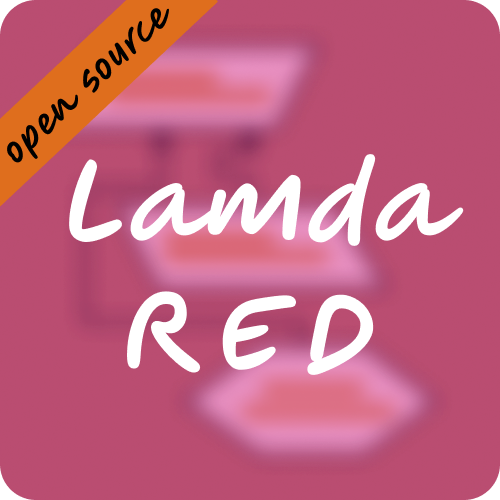
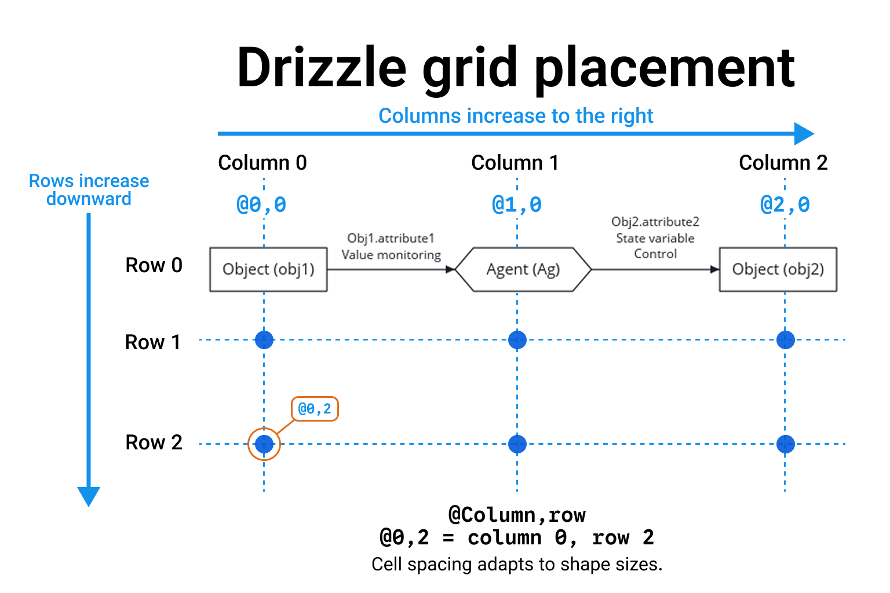

<div align="center">
    
    <h1>Lamda RED</h1>
    <p>
        <a href="../en/README.md">English</a> ·
        <a href="../ru/README.md">Русский</a> ·
        <a href="../fa/README.md">فارسی</a> ·
        <a href="../ar/README.md">العربية</a> ·
        <a href="../tr/README.md">Türkçe</a> ·
        <a href="../zh-CN/README.md">简体中文</a> ·
        <a href="../de/README.md">Deutsch</a> ·
        <a href="../es/README.md">Español</a> ·
        <a href="../ko/README.md">한국어</a>
    </p>
    <p>일반 텍스트로 만드는 요구사항 공학 다이어그램</p>
</div>

Lamda RED는 일반 텍스트 `.zz` 파일을 요구사항 다이어그램으로 변환합니다. 시스템이 달성해야 할 목표, 발생할 수 있는 위험, 에이전트와 시스템 객체의 상호 작용을 표현할 수 있습니다. 요구사항 문서와 함께 소스를 Git에 보관하면 팀에서 변경 내용을 diff로 검토하고 이미지를 다시 생성할 수 있습니다.

**Drizzle**로 다이어그램을 작성하고 **`lmdred`**로 컴파일합니다. 컴파일러는 문서에 넣을 PNG와 diagrams.net(draw.io)에서 편집할 수 있는 mxGraph XML을 생성합니다. `--export-set`을 사용하면 소용량, 문서용, 고해상도 PNG를 한 번에 얻을 수 있습니다. 데스크톱 VS Code의 확장은 편집기 옆에 미리보기를 표시하고 저장하거나 **Export diagram**을 누를 때 결과를 내보냅니다.

## Drizzle에서 다이어그램까지

예제의 에이전트는 한 객체의 값을 모니터링하고 다른 객체를 제어합니다. 아래 그림은 렌더링 결과입니다.


예제를 `object-agent.zz`로 저장합니다.

```drizzle
Input = [Object (obj1)]
Monitor = <Agent (Ag)>
Output = [Object (obj2)]

Input __> Monitor : Obj1.attribute1\nValue monitoring
Monitor __> Output : Obj2.attribute2\nState variable\nControl
```

컴파일러를 설치한 뒤 파일이 있는 디렉터리에서 다음 명령을 실행하면 `object-agent.png`와 `object-agent.xml`이 생성됩니다.

```sh
lmdred object-agent.zz object-agent
```

[설치](#installation) · [VS Code 미리보기](../../README.md#live-preview-in-vs-code) · [Drizzle 문법 안내서](#drizzle-syntax)

- [CLI 사용법](#cli-usage)
- [Drizzle 문법](#drizzle-syntax)
- [VS Code용 Drizzle 확장](./vscode.md)
- [설치](#installation)
- [소스와 개발](#source-and-development)
  - [소스 준비](#set-up-the-source)
  - [실행과 디버깅](#run-and-debug)
  - [테스트와 검사](#test-and-check)
  - [빌드와 패키징](#build-and-package)
  - [컴파일러 릴리스 게시](#publish-a-compiler-release)
- [개발자 가이드](../../DEVELOPER.md)
- [기여 가이드](../../CONTRIBUTING.md)
- [행동 강령](../../CODE_OF_CONDUCT.md)
- [변경 내역](./CHANGELOG.md)
- [로드맵](#roadmap)
- [라이선스](#license)

<a name="cli-usage"></a>

## CLI 사용법

설치한 명령은 모든 디렉터리에서 호출할 수 있습니다.

```text
lmdred [input.zz] [output-stem]
lmdred --help
lmdred --version
```

| 인수 또는 옵션 | 의미 | 기본값 |
| --- | --- | --- |
| `input.zz` | UTF-8 Drizzle 소스 파일 경로 | 현재 디렉터리의 `sample.zz` |
| `output-stem` | `.png` 및 `.xml` 확장자를 붙이기 전의 출력 경로 | 현재 디렉터리의 `output` |
| `-h`, `--help` | 명령줄 도움말 표시 |  |
| `-V`, `--version` | 컴파일러 버전 표시. 예를 들어 `lmdred 1.2.0` |  |
| `--` | 남은 인수를 파일 경로로 처리 |  |

<a name="output-paths"></a>

### 출력 경로

상대 경로는 터미널의 현재 작업 디렉터리를 기준으로 해석합니다. 다른 위치를 지정하려면 절대 경로를 넘깁니다. 출력 디렉터리는 미리 만들어야 합니다. 컴파일러는 지정된 기본 이름에 확장자를 붙입니다.

| 명령 | 현재 디렉터리를 기준으로 작성되는 파일 |
| --- | --- |
| `lmdred sample.zz my-new-red` | `my-new-red.png` 및 `my-new-red.xml` |
| `lmdred sample.zz` | `output.png` 및 `output.xml` |
| `lmdred` | `sample.zz`를 읽고 `output.png` 및 `output.xml` 작성 |
| `lmdred diagrams/train.zz` | `output.png` 및 `output.xml` |
| `lmdred diagrams/train.zz reports/train` | `reports/train.png` 및 `reports/train.xml` |
| `lmdred sample.zz train.v1` | `train.v1.png` 및 `train.v1.xml` |

공백이 있는 경로는 따옴표로 묶습니다. 경로가 하이픈으로 시작하면 `--`를 사용합니다(하이픈 기호는 `-`).

```sh
lmdred "my diagrams/train.zz" "my diagrams/train"
lmdred -- "-file.zz" result
```

<a name="output-formats-and-errors"></a>

### 출력 형식과 오류

PNG의 캔버스에는 모든 도형, 연결 및 레이블이 포함됩니다. mxGraph XML에는 diagrams.net/draw.io에서 편집할 수 있는 도형, 연결 및 경유점이 들어 있습니다.

성공하면 출력 경로 두 개를 표시하고 상태 `0`으로 종료합니다. 실패하면 표준 오류에 메시지를 쓰고 상태 `1`로 종료합니다. 구문 및 참조 오류에는 파일, 줄 및 열이 표시됩니다.

저장에 성공하면 선택한 위치에 있는 기존 출력 파일을 덮어씁니다. 컴파일러는 출력 경로가 소스 파일을 덮어쓰지 않는지 확인합니다. 두 파일을 쓰기 전에 파싱과 렌더링을 마칩니다. 파일 시스템 오류가 발생하면 출력 하나만 작성될 수 있습니다. 메시지를 확인하고 경로나 권한을 고친 뒤 다시 실행합니다.

<a name="drizzle-syntax"></a>

## Drizzle 문법

PNG는 문서 및 프레젠테이션에 사용합니다. 검토자가 목표, 위험, 에이전트 및 관계를 추적하고 수정할 수 있도록 Drizzle 파일을 요구사항과 함께 보관합니다. 컴파일할 때마다 편집 가능한 mxGraph XML도 생성됩니다.

<a name="a-first-diagram"></a>

### 첫 다이어그램

예제를 `first.zz`로 저장한 뒤 `lmdred first.zz first`를 실행합니다.

```drizzle
&& The tracking agent reports train speed and location.
Tracking = <Tracking system>
Train = [Train]
Tracking __> Train : currentSpeed\ncurrentLocation
```

결과에는 육각형 에이전트, 직사각형 객체 및 열차를 향하는 실선 화살표가 있습니다. 화살표 위 레이블은 두 줄입니다.

<a name="declare-nodes"></a>

### 노드 선언

연결에서 노드를 참조할 수 있도록 `ID = shape`로 선언합니다. ID는 대소문자를 구분하고 ASCII 문자로 시작하며, 영문자와 숫자 및 영숫자 사이의 단일 밑줄을 허용합니다. `Train_1`은 ID의 예입니다. 도형 내부 텍스트는 화면에 표시되는 레이블입니다. 연결은 선언 앞뒤에 올 수 있습니다. 주석은 줄 맨 앞에 `&&`를 씁니다. 빈 줄과 들여쓰기가 허용됩니다.

`/Safe journey/`처럼 도형만 쓸 수도 있습니다. 연결에서 사용할 도형에는 ID를 지정합니다.

| 도형 | 선언 | 결과 |
| --- | --- | --- |
| 목표 | `G = /Safe journey/` | 오른쪽으로 기울어진 평행사변형 |
| 위험 | `R = \Signal lost\` | 반대로 기울어진 평행사변형 |
| 에이전트 | `A = <Train controller>` | 육각형 |
| 서술문 | `D = ~Doors are locked in motion~` | 밑변이 더 넓은 사다리꼴 |
| 객체 | `O = [Train]` | 직사각형 |
| 동작 | `Send = (Send command)` | 타원 |
| 메모 | `N = {Controller responsibility}` | 파선 테두리가 있는 연한 녹색 직사각형 |
| 구름 주석 | `C = {{Reason for the obstacle}}` | 구름 모양 테두리 |
| 마름모 | `Check = ^Speed confirmed?^` | 마름모 |

도형 앞에 `!`를 붙여 윤곽선을 굵게 표시합니다. 참조 표기에서는 요구사항과 가정 같은 잎 노드에 이 표기를 사용합니다. 레이블의 굵기는 그대로 유지됩니다.

```drizzle
/Goal/
!/Leaf requirement/
~Descriptive~
<Agent 1>
```

<a name="labels-and-line-breaks"></a>

#### 레이블과 줄바꿈

레이블에 오른쪽에서 왼쪽으로 쓰는 문자를 포함한 UTF-8을 사용할 수 있습니다. 렌더러는 텍스트 크기를 측정하고 도형 중앙에 놓으며 도형 크기도 조정합니다. 긴 레이블은 가능한 한 단어 단위로 줄바꿈하며, 너무 긴 단어는 내부에서 나눌 수 있습니다. 도형 레이블은 최대 네 줄, 연결 레이블은 최대 세 줄을 표시합니다. 제한을 넘은 부분은 `...`로 표시하며 전체 레이블은 소스에 남습니다.

| 문법 | 결과 |
| --- | --- |
| `/Accurate estimate\nof speed and position/` | 줄바꿈이 있는 목표 레이블 |
| `[C:\\Logs]` | 레이블이 `C:\Logs`인 직사각형 |
| `<Speed \> zero>` | 레이블이 `Speed > zero`인 에이전트 |
| `/Input \/ output/` | 레이블이 `Input / output`인 목표 |
| `~Value \~ threshold~` | 레이블이 `Value ~ threshold`인 사다리꼴 |

강제 줄바꿈은 `\n`, 리터럴 역슬래시는 `\\`로 씁니다. 구분자를 레이블 안에 표시하려면 그 앞에 역슬래시를 붙입니다.

<a name="connect-nodes"></a>

### 노드 연결

연산자 양쪽에 노드 ID를 씁니다. 가운데 두 문자가 선 종류를 결정하며, 바깥쪽의 `<` 및 `>`는 각각 왼쪽과 오른쪽 끝에 화살촉을 추가합니다. 읽기 쉽게 ID와 연산자 사이를 띄어 쓸 수 있습니다.

| 방향 | 실선 | 파선 |
| --- | --- | --- |
| 화살촉 없음 | `A __ B` | `A -- B` |
| B를 향함 | `A__>B` | `A-->B` |
| A를 향함 | `A<__B` | `A<--B` |
| 양 끝을 향함 | `A<__>B` | `A<-->B` |

연결 및 옵션 뒤에 콜론을 붙이면 레이블을 추가할 수 있습니다. 같은 두 노드를 잇는 연결마다 다른 레이블과 경로를 지정할 수 있습니다. 중복 연결은 한 번만 그립니다. 노드를 자기 자신에게 연결하면 루프가 됩니다.

```drizzle
Tracking = <Tracking system>
Train = [Train]
Tracking __> Train : currentSpeed\ncurrentLocation
Tracking <__ Train : measuredSpeed\nmeasuredLocation
Train --> Train : Refresh state
```

<a name="add-notation-to-a-connection"></a>

#### 연결에 표식 추가

| 옵션 | 예제 | 결과 |
| --- | --- | --- |
| `[o]` | `A __ B [o]` | 선 위의 빈 원 |
| `[*]` | `A __> B [*]` | 선 위의 채운 원 |
| `[zigzag]` | `A __ B [zigzag]` | 충돌을 나타내는 지그재그 |
| `[bar]` | `Risk --> Goal [bar]` | 장애물을 나타내는 가로 막대 |
| `[ortho]` | `A __> B [ortho]` | 수평 및 수직 선분으로 이루어진 경로 |

연결마다 원, 지그재그, 가로 막대 가운데 하나만 사용합니다. 표식은 `[ortho]` 및 두 선 종류와 함께 쓸 수 있습니다. 화살표가 하나인 연결의 막대는 화살촉 가까이에, 화살표가 없거나 두 개인 연결의 막대는 경로 가운데에 놓입니다.

<a name="join-several-sources"></a>

#### 여러 출발 노드 합치기

같은 대상에 도착하는 연결은 선 종류, 표식, 레이블 및 경로 옵션이 일치하면 마지막 구간을 공유합니다. 명시한 우회 경로는 독립적으로 유지됩니다. 공유 연결을 직접 선언하려면 출발 노드 ID를 쉼표로 구분합니다. 빈 원이나 채운 원은 합류점에 놓이며, 오른쪽 화살촉은 대상을, 명시적인 분기의 왼쪽 화살촉은 각각의 출발 노드를 향합니다.

```drizzle
layout up
Goal @1,0 = /Safe departure/
Software @0,1 = !/Verify the lock signal/
Assumption @2,1 = !/The door sensor works/

Software, Assumption __> Goal [o]
```

두 잎 노드는 빈 원이 있는 공통 선에 합쳐지고, 하나의 화살표가 위쪽 목표를 향합니다. `Software __> Goal [o]` 및 `Assumption __> Goal [o]`를 별도 줄에 작성해도 같은 결과가 나옵니다.

<a name="set-the-layout-and-routing"></a>

### 레이아웃과 경로 설정

| 설정 | 예제 | 결과 |
| --- | --- | --- |
| 방향 | `layout right` | 왼쪽에서 오른쪽으로 자동 배치. 기본값 |
| 방향 | `layout left` | 오른쪽에서 왼쪽으로 자동 배치 |
| 방향 | `layout up` | 아래에서 위로 직각 경로를 사용해 자동 배치 |
| 방향 | `layout down` | 위에서 아래로 직각 경로를 사용해 자동 배치 |
| 격자 배치 | `Goal @2,0 = /Goal/` | 도형을 2열 0행에 배치 |
| 외곽 경로 | `A --> B [bar] via bottom` | 연결을 다이어그램 아래쪽으로 우회 |

다이어그램마다 레이아웃 지시문을 하나까지만 씁니다. 좌표는 0부터 시작하며 열은 오른쪽, 행은 아래쪽으로 증가합니다. 명시적으로 지정한 셀에는 노드 하나만 놓을 수 있습니다. Lamda RED는 도형에 맞춰 행과 열의 크기를 정하고, 다이어그램이 모두 들어가도록 PNG 캔버스를 조정합니다. 자동 배치와 명시적 배치를 함께 쓸 수 있습니다.

다음 그림은 객체와 에이전트 예제를 0행에 배치합니다. 점선과 교차점은 격자 좌표를 보여 줍니다. 강조된 `@0,2` 교차점은 0열 2행입니다.



```drizzle
Input @0,0 = [Object (obj1)]
Monitor @1,0 = <Agent (Ag)>
Output @2,0 = [Object (obj2)]

Input __> Monitor : Obj1.attribute1\nValue monitoring
Monitor __> Output : Obj2.attribute2\nState variable\nControl
```

강조된 교차점에 메모를 두려면 `Explanation @0,2 = {Column zero, row two}`를 추가합니다. 좌표는 셀을 선택하며 픽셀 위치는 도형의 크기에 따라 달라집니다.

연결 옵션 뒤, 레이블 앞에 `via right`, `via left`, `via top` 또는 `via bottom`를 씁니다. 충돌이나 장애물 연결이 다른 관계를 우회할 때 유용합니다.

```drizzle
layout up
Login @0,0 = /User can sign in/
Blocked @0,1 = \User cannot sign in\
Recover @0,2 = /Recover using a phone number/

Recover __> Blocked
Blocked __> Login
Recover __> Login [zigzag] via right : A non-user might gain access
```

처음 두 연결은 트리를 따라 위로 향합니다. 충돌 경로는 오른쪽을 돌아 목표를 가리킵니다.

<a name="reference-diagrams"></a>

### 참조 다이어그램

각 예제는 링크된 Drizzle 파일을 컴파일한 결과입니다. 드모르간 다이어그램을 만들려면 `lmdred sample/de-morgan.zz de-morgan`를 실행합니다. 다른 예제 경로와 출력 기본 이름을 지정해도 됩니다.

<a name="goal-notation-and-obstacles"></a>

#### 목표 표기와 장애물

굵은 윤곽선은 잎 노드를 구분하고, 사다리꼴에는 서술문을 기록합니다. 반대로 기울어진 위험 도형은 장애물 막대를 거쳐 목표를 향하고, 설명 메모는 구름 안에 놓입니다. [Drizzle 소스](../../sample/notation.zz).


<a name="requirement-refinement"></a>

#### 요구사항 구체화

독립된 연결을 사용하면 구체화한 요구사항과 잎 노드에서 각각의 표식과 화살촉을 지정할 수 있습니다. [Drizzle 소스](../../sample/requirements.zz).


<a name="rail-goal-conflicts"></a>

#### 철도 목표 충돌

분기는 여러 구체화 관계를 한 지점에서 합칩니다. 지그재그 선은 트리에서 충돌하는 목표를 연결합니다. [Drizzle 소스](../../sample/rail-conflicts.zz).


<a name="authentication-risk"></a>

#### 인증 위험

반대로 기울어진 도형은 로그인을 방해하는 문제를 뜻합니다. 외곽 지그재그는 복구 옵션 때문에 생길 수 있는 충돌을 나타냅니다. [Drizzle 소스](../../sample/auth-risk.zz).


<a name="de-morgan-goal-and-risk-diagram"></a>

#### 드모르간 목표와 위험 다이어그램

소스는 목표와 그 부정, 공유 구체화 분기 및 파선으로 된 장애물 관계 세 개를 명시합니다. [Drizzle 소스](../../sample/de-morgan.zz).


<a name="agent-monitoring-and-control"></a>

#### 에이전트 모니터링과 제어

육각형 에이전트는 첫 번째 객체의 속성을 받아 두 번째 객체의 속성을 제어합니다. [Drizzle 소스](../../sample/object-agent.zz).


<a name="train-control"></a>

#### 열차 제어

한 다이어그램에 실선과 파선, 측정 및 명령을 위한 별도 화살표, 동작 타원 및 책임 메모가 표시됩니다. [Drizzle 소스](../../sample.zz).


<a name="editor-and-diagnostics"></a>

### 편집기와 진단

`drizzle/`의 VS Code 확장은 `.zz`, `.drizzle` 및 `.rd` 파일을 강조합니다. 현재 문법을 시험하려면 VS Code에서 해당 폴더를 열고 **F5**를 눌러 Extension Development Host를 시작한 다음 호스트 창에서 다이어그램 소스를 엽니다. [VS Code 확장 문서](https://code.visualstudio.com/api/get-started/your-first-extension).

| 메시지 또는 증상 | 해결 방법 |
| --- | --- |
| `unknown node 'X'` | 대소문자가 일치하도록 `X`를 선언하거나 참조를 고칩니다. |
| `duplicate ID` | 각 노드에 고유한 ID를 지정합니다. |
| `cell @… is already occupied` | 노드 하나를 다른 격자 셀에 배치합니다. |
| `invalid Drizzle syntax` | 메시지의 파일, 줄 및 열을 사용해 구분자, 연산자 또는 잘못 배치한 옵션을 찾습니다. |
| `diagram is too large for PNG output` | 떨어진 격자 좌표를 가까이 옮기거나 모델을 여러 다이어그램으로 나눕니다. |
| `no system fonts found` | 산세리프 글꼴을 설치하고 컴파일러를 다시 실행합니다. |
| `link.exe not found` | MSVC 빌드 도구를 설치하거나 위 GNU 명령을 실행합니다. |

<a name="installation"></a>

## 설치

릴리스 워크플로가 파일을 업로드한 뒤 아래 명령으로 컴파일러 릴리스 `lmdred-v1.2.0`를 다운로드할 수 있습니다.

설치 프로그램은 x64 또는 ARM64를 선택하고 압축 파일과 SHA-256 체크섬을 다운로드해 검증한 뒤 사용자 계정에 `lmdred`를 설치합니다. 업그레이드하거나 설치를 복구하려면 다시 실행합니다.

<a name="linux-and-macos"></a>

### Linux와 macOS

curl로 셸 설치 스크립트를 내려받아 실행합니다.

```sh
curl -fL https://github.com/Asncodes-80/lamda_red/releases/download/lmdred-v1.2.0/install.sh -o install-lmdred.sh
sh install-lmdred.sh
```

wget으로도 내려받을 수 있습니다.

```sh
wget https://github.com/Asncodes-80/lamda_red/releases/download/lmdred-v1.2.0/install.sh -O install-lmdred.sh
sh install-lmdred.sh
```

기본 설치 경로는 `$HOME/.local/bin`입니다. 설치 프로그램은 `~/.profile`와 현재 Bash, Zsh 또는 Fish 셸의 시작 파일을 갱신합니다. 설치가 끝나면 새 터미널을 엽니다. Bash, Zsh 또는 sh에서는 현재 터미널에서도 즉시 명령을 활성화할 수 있습니다.

```sh
export PATH="$HOME/.local/bin:$PATH"
lmdred --version
```

다음 옵션으로 버전 또는 설치 경로를 선택합니다.

```sh
sh install-lmdred.sh --version 1.2.0 --bin-dir "$HOME/.local/bin"
sh install-lmdred.sh --no-modify-path
```

환경 변수 `LMDRED_VERSION` 및 `LMDRED_INSTALL_DIR`가 기본값을 제공합니다. 명시적으로 지정한 CLI 옵션이 우선합니다. 다른 셸에서는 시작 설정에 설치 경로를 추가합니다.

<a name="windows"></a>

### Windows

PowerShell에서 설치 프로그램을 내려받아 실행합니다.

```powershell
$installer = Join-Path $env:TEMP 'install-lmdred.ps1'
Invoke-WebRequest -Uri 'https://github.com/Asncodes-80/lamda_red/releases/download/lmdred-v1.2.0/install.ps1' -OutFile $installer
powershell -NoProfile -ExecutionPolicy Bypass -File $installer
```

새 터미널을 열고 `lmdred --version`를 실행합니다. 설치 프로그램은 실행 파일을 `%LOCALAPPDATA%\Programs\lmdred\bin`에 넣고 해당 디렉터리를 사용자 PATH 맨 앞에 배치해 Cargo로 설치한 사본보다 우선하도록 합니다. 시스템 전체에 설치된 사본이 우선하는 경우 그 경로를 표시합니다. `Get-Command lmdred -All`로 어떤 사본이 선택되는지 확인할 수 있습니다.

다른 경로를 선택하거나 PATH를 직접 관리하려면 다음 옵션을 사용합니다.

```powershell
powershell -NoProfile -ExecutionPolicy Bypass -File $installer -Version 1.2.0 -InstallDirectory "$env:LOCALAPPDATA\Programs\lmdred\bin"
powershell -NoProfile -ExecutionPolicy Bypass -File $installer -NoModifyPath
```

Windows에서도 `LMDRED_VERSION` 및 `LMDRED_INSTALL_DIR`로 기본값을 설정할 수 있습니다.

<a name="download-an-archive-directly"></a>

### 압축 파일 직접 다운로드

시스템에 맞는 파일을 풀고 실행 파일을 PATH에 포함된 디렉터리에 놓습니다.

| 시스템 | 프로세서 | 릴리스 압축 파일 |
| --- | --- | --- |
| Windows | x64 | `lmdred-v1.2.0-x86_64-pc-windows-msvc.zip` |
| Windows | ARM64 | `lmdred-v1.2.0-aarch64-pc-windows-msvc.zip` |
| macOS | Intel | `lmdred-v1.2.0-x86_64-apple-darwin.tar.gz` |
| macOS | Apple Silicon | `lmdred-v1.2.0-aarch64-apple-darwin.tar.gz` |
| Linux | x64 | `lmdred-v1.2.0-x86_64-unknown-linux-musl.tar.gz` |
| Linux | ARM64 | `lmdred-v1.2.0-aarch64-unknown-linux-musl.tar.gz` |

Linux 릴리스는 glibc와 musl 배포판에서 실행되도록 musl을 사용합니다. Windows 릴리스는 C 런타임을 정적으로 링크합니다. 렌더링에는 시스템 글꼴을 사용합니다. 최소 구성의 Linux 서버나 컨테이너에는 DejaVu Sans 같은 산세리프 글꼴을 설치합니다.

<a name="install-from-source"></a>

### 소스에서 설치

Rust와 플랫폼 빌드 도구를 설치한 뒤 저장소 루트에서 다음 명령을 실행합니다.

```sh
cargo install --path . --locked
```

Cargo는 `lmdred`를 `~/.cargo/bin`에 설치합니다. Windows에서는 `%USERPROFILE%\.cargo\bin`에 설치합니다. 필요한 경우 그 디렉터리를 PATH에 추가합니다. GitHub 소스에서 직접 설치할 수도 있습니다.

```sh
cargo install --git https://github.com/Asncodes-80/lamda_red --locked --bin lmdred
```

Windows GNU 도구 체인에서는 다음 명령을 사용합니다.

```powershell
cargo +stable-x86_64-pc-windows-gnu install --path . --locked
```

<a name="source-and-development"></a>

## 소스와 개발

컴파일러는 UTF-8 소스 파일을 읽고 노드와 연결을 파싱하며 레이블의 크기를 측정하고, 배치와 경로를 계산한 뒤 다이어그램을 내보냅니다.

| 위치 | 역할 |
| --- | --- |
| [src/main.rs](../../src/main.rs) | CLI 인수, 파일 경로, 오류 및 컴파일 과정 |
| [src/lamda_red_grammar.pest](../../src/lamda_red_grammar.pest) | Drizzle 문법 |
| [src/parsing.rs](../../src/parsing.rs) | 다이어그램 모델, 선언, 참조 및 구문 진단 |
| [src/labels.rs](../../src/labels.rs) | 글꼴 탐색, 글자 조형, 줄바꿈 및 말줄임 |
| [src/layout.rs](../../src/layout.rs) | 도형의 기하 구조, 격자 배치 및 캔버스 범위 |
| [src/routing.rs](../../src/routing.rs) | 연결, 분기, 우회 경로 및 연결 레이블 위치 |
| [src/export.rs](../../src/export.rs) | PNG 및 mxGraph XML 생성 |
| [sample.zz](../../sample.zz) 및 [sample/](../../sample/) | 열차 제어와 기타 참조 다이어그램 |
| [tests/test_cli_install.py](../../tests/test_cli_install.py) | CLI 및 릴리스 설치 프로그램 통합 검사 |
| [scripts/](../../scripts/) | 설치 프로그램 및 릴리스 압축 파일 생성 |
| [.github/workflows/release-cli.yml](../../.github/workflows/release-cli.yml) | 여섯 대상 플랫폼의 빌드, 검사 및 릴리스 |
| [drizzle/](../../drizzle/) | VS Code 구문 강조 확장 |

<a name="set-up-the-source"></a>

### 소스 준비

최신 안정 버전의 Rust 도구 체인, Cargo 및 플랫폼의 기본 빌드 도구를 설치합니다. CLI와 설치 프로그램의 통합 검사에는 Python 3이 필요합니다. 패키징 도구는 Windows PowerShell 5.1 또는 PowerShell 7에서 실행됩니다. PNG 렌더링에는 시스템에 설치된 글꼴이 사용됩니다. [Rust 설치](https://www.rust-lang.org/tools/install).

```sh
git clone https://github.com/Asncodes-80/lamda_red.git
cd lamda_red
cargo build --locked
```

Windows에서 MSVC로 빌드하려면 Visual Studio C++ 빌드 도구가 필요합니다. macOS에는 Xcode 명령줄 도구를, Linux에는 C 컴파일러와 링커를 설치합니다. 최소 구성 Linux에는 DejaVu Sans 같은 글꼴도 필요합니다.

Windows에서 GNU 도구 체인을 사용하려면 다음 명령을 실행합니다. 이 안내서의 다른 빌드, 실행, 테스트 및 설치 명령에서도 `+stable-x86_64-pc-windows-gnu` 옵션을 `cargo` 바로 뒤에 넣을 수 있습니다.

```powershell
rustup toolchain install stable-x86_64-pc-windows-gnu --profile minimal --component clippy,rustfmt
cargo +stable-x86_64-pc-windows-gnu build --locked
```

`Cargo.lock` 파일을 저장소에 유지하고 `--locked` 옵션으로 커밋된 의존성 버전을 사용합니다.

<a name="run-and-debug"></a>

### 실행과 디버깅

Cargo의 개발 빌드에는 디버그 정보가 포함됩니다. 다음 명령으로 참조 다이어그램을 컴파일합니다.

```sh
cargo run --locked -- sample/requirements.zz target/requirements
cargo run --locked -- --help
cargo run --locked -- --version
```

첫 명령은 `target/requirements.png` 및 `target/requirements.xml`를 작성합니다. `cargo run --locked`만 실행하면 `sample.zz`를 읽고, 저장소 루트에 `output.png` 및 `output.xml`를 작성합니다.

VS Code에서 디버깅하려면 저장소 루트를 열고 CodeLLDB를 설치한 뒤 다음 설정을 `.vscode/launch.json`에 추가합니다. 이 설정은 Cargo로 `lmdred`를 빌드하고 저장소 상대 경로를 사용해 예제를 엽니다. [CodeLLDB 설정 참조](https://github.com/vadimcn/codelldb/blob/master/MANUAL.md#cargo-support).

```json
{
  "version": "0.2.0",
  "configurations": [
    {
      "name": "Debug lmdred",
      "type": "lldb",
      "request": "launch",
      "cargo": {
        "args": ["build", "--locked", "--bin", "lmdred"],
        "filter": { "name": "lmdred", "kind": "bin" }
      },
      "args": ["sample/requirements.zz", "target/debug-diagram"],
      "cwd": "${workspaceFolder}",
      "env": { "RUST_BACKTRACE": "1" },
      "sourceLanguages": ["rust"]
    }
  ]
}
```

`run` 함수(`src/main.rs`에 위치)에 중단점을 지정하고 **F5**를 누릅니다. 모델은 `parsing::parse`, 위치와 경로는 `layout::arrange`, 출력은 `export::png` 또는 `export::xml`로 들어가 확인합니다. 디버그 설정에서 GNU 도구 체인을 명시하려면 Cargo 인수를 `["+stable-x86_64-pc-windows-gnu", "build", "--locked", "--bin", "lmdred"]`로 변경합니다.

<a name="test-and-check"></a>

### 테스트와 검사

저장소 루트에서 Rust 테스트, 포맷 검사 및 린터를 실행합니다.

```sh
cargo test --locked
cargo fmt --check
cargo clippy --locked --all-targets -- -D warnings
```

Rust 테스트는 파싱과 참조, 표식과 분기, 하위 호환성, 장애물 우회 경로 및 텍스트 줄바꿈과 말줄임을 검증합니다.

CLI와 설치 프로그램을 확인하려면 릴리스 실행 파일을 빌드하고 그 경로를 통합 검사에 전달합니다.

```sh
cargo build --locked --release
python tests/test_cli_install.py --binary target/release/lmdred
```

Windows에서는 `target/release/lmdred.exe`를 사용합니다. Rust 대상을 직접 지정했다면 `target/<target>/release/lmdred` 또는 `lmdred.exe`를 사용합니다. 통합 검사는 저장소 밖에서 렌더링하며, 공백이 있는 경로와 기본 출력 값을 검사하고, 로컬 HTTP로 릴리스 압축 파일을 제공합니다. 임시 디렉터리에서 설치와 재설치를 수행하고, 잘못된 체크섬을 거부하면서 설치된 실행 파일을 보존하는지 검증합니다.

<a name="build-and-package"></a>

### 빌드와 패키징

```sh
cargo build --locked
cargo build --locked --release
```

개발 빌드는 `target/debug/`, 최적화 빌드는 `target/release/`에 생성됩니다. 실행 파일 이름은 Linux 및 macOS에서 `lmdred`, Windows에서 `lmdred.exe`입니다.

Windows에서는 대상을 빌드한 뒤 Windows PowerShell 5.1로 패키징합니다. PowerShell 7을 사용한다면 `pwsh`를 `powershell.exe` 대신 실행합니다.

```powershell
$compilerTarget = ((rustc -vV | Select-String '^host: ').Line -split ': ', 2)[1]
cargo build --locked --release --target $compilerTarget
powershell.exe -NoProfile -ExecutionPolicy Bypass -File .\scripts\package-release.ps1 -Target $compilerTarget
```

두 단계 모두 활성 Rust 도구 체인의 대상을 사용합니다. Windows x64 대상은 `x86_64-pc-windows-msvc` 또는 `x86_64-pc-windows-gnu`입니다. 실행 파일은 `target/<target>/release/`에 있습니다. 압축 파일과 `.sha256` 파일은 `target/dist/`에 작성됩니다. 압축 파일에는 실행 파일, 라이선스, README 및 `sample.zz`가 포함됩니다. Unix 대상은 `.tar.gz` 형식을 사용합니다.

<a name="publish-a-compiler-release"></a>

### 컴파일러 릴리스 게시

릴리스 워크플로는 Windows, macOS, Linux의 x64와 ARM64용 네이티브 바이너리를 빌드하고 테스트합니다. 플랫폼별 압축 파일, SHA-256 체크섬, 두 설치 스크립트 및 통합 `SHA256SUMS` 파일을 업로드합니다.

1. 저장소의 **Actions** 탭에서 **Version Bump** 워크플로([`.github/workflows/version-bump.yml`](../../.github/workflows/version-bump.yml))를 실행하고 `patch`, `minor`, 또는 `major`를 선택합니다. 이 워크플로는 `Cargo.toml` 버전을 올리고, `Cargo.lock`을 동기화하며, `CHANGELOG.md`를 갱신하고, `scripts/install.sh` 및 `scripts/install.ps1`의 기본 버전과 이 README 및 [다국어 README](../)의 버전 지정 다운로드 URL과 설치 명령을 갱신하는 Pull Request를 생성합니다. 저장소 설정에서 GitHub Actions의 Pull Request 생성이 허용되어 있어야 합니다.
2. 버전 올리기 Pull Request를 검토한 뒤 `main`에 병합합니다. 버전 올리기 워크플로에서는 병합 후에만 태그를 생성하도록 태그 지정이 의도적으로 비활성화되어 있습니다.
3. PR 병합 후 로컬 `main`을 최신화하고 `Cargo.toml`과 일치하는 `lmdred-v<version>` 태그를 병합된 릴리스 커밋에 생성해 푸시합니다:

```sh
git switch main
git pull origin main
git tag lmdred-v1.2.0
git push origin lmdred-v1.2.0
```

이 태그를 푸시하면 [`.github/workflows/release-cli.yml`](../../.github/workflows/release-cli.yml)이 실행되어 태그와 `Cargo.toml` 및 두 설치 스크립트의 일치를 검증하고 모든 빌드가 통과한 후 컴파일러 릴리스를 생성합니다. 같은 컴파일러 태그로 GitHub 릴리스를 수동 게시해도 워크플로가 시작되며 해당 릴리스에 파일을 첨부합니다. **Run workflow** 버튼은 선택한 브랜치의 다운로드 가능한 Actions 아티팩트를 빌드합니다.

**Version Bump** 워크플로 대신 수동으로 릴리스를 준비할 때는 태그를 푸시하기 전에 `Cargo.toml`, `Cargo.lock`, `CHANGELOG.md`, 두 설치 프로그램의 기본 버전, README의 버전 지정 설치 명령을 갱신하세요. 컴파일러 태그의 접두사는 `lmdred-v`입니다. VS Code 확장은 `drizzle-` 태그와 `drizzle/package.json`의 독립된 버전을 사용합니다.

<a name="roadmap"></a>

## 로드맵

- Lamda RED의 Pest 문법을 위한 상태 머신 다이어그램을 작성합니다.
- React 앱이 Rust 서버에 렌더링된 PNG를 요청하는 웹 서비스를 개발합니다.

<a name="license"></a>

## 라이선스

프로젝트는 [GNU GPLv3](../../LICENSE)에 따라 배포됩니다.
