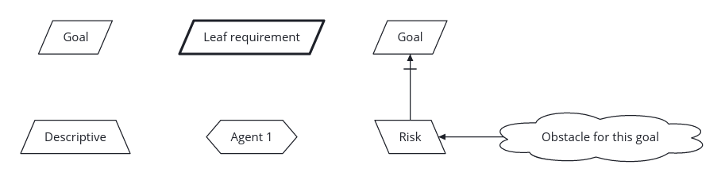
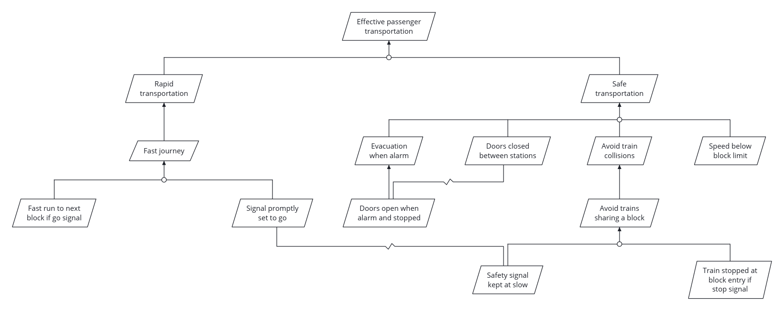
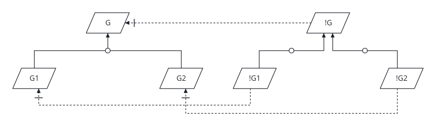

<div align="center">
    
    <h1>Lamda RED</h1>
    <p>
        <a href="../en/README.md">English</a> ·
        <a href="../ru/README.md">Русский</a> ·
        <a href="../fa/README.md">فارسی</a> ·
        <a href="../ar/README.md">العربية</a> ·
        <a href="../tr/README.md">Türkçe</a> ·
        <a href="../zh-CN/README.md">简体中文</a> ·
        <a href="../de/README.md">Deutsch</a> ·
        <a href="../es/README.md">Español</a> ·
        <a href="../ko/README.md">한국어</a>
    </p>
    <p>Диаграммы инженерии требований из обычного текста</p>
</div>

Lamda RED превращает текстовые файлы `.zz` в диаграммы требований. Покажите, чего должна достичь система, какие риски этому мешают и как взаимодействуют агенты и объекты. Храните исходники рядом с требованиями в Git, чтобы команда могла проверять изменения в diff и заново строить изображения.

Опишите диаграмму на **Drizzle** и скомпилируйте её командой **`lmdred`**. Компилятор создаёт PNG для документов и редактируемый mxGraph XML для diagrams.net (draw.io). Опция `--export-set` создаёт компактный PNG, PNG для документов и PNG высокого разрешения. Расширение для настольного VS Code показывает диаграмму рядом с редактором и экспортирует её при сохранении или кнопкой **Export diagram**.

## От Drizzle к диаграмме

В примере агент отслеживает значение одного объекта и управляет другим. Ниже показан результат.


Сохраните пример как `object-agent.zz`.

```drizzle
Input = [Object (obj1)]
Monitor = <Agent (Ag)>
Output = [Object (obj2)]

Input __> Monitor : Obj1.attribute1\nValue monitoring
Monitor __> Output : Obj2.attribute2\nState variable\nControl
```

После установки компилятора выполните команду в каталоге файла. Она создаёт `object-agent.png` и `object-agent.xml`.

```sh
lmdred object-agent.zz object-agent
```

[Установка](#installation) · [Предпросмотр в VS Code](../../README.md#live-preview-in-vs-code) · [Справочник по синтаксису Drizzle](#drizzle-syntax)

- [Использование CLI](#cli-usage)
- [Синтаксис Drizzle](#drizzle-syntax)
- [Расширение Drizzle для VS Code](./vscode.md)
- [Установка](#installation)
- [Исходный код и разработка](#source-and-development)
  - [Подготовка исходного кода](#set-up-the-source)
  - [Запуск и отладка](#run-and-debug)
  - [Тесты и проверки](#test-and-check)
  - [Сборка и упаковка](#build-and-package)
  - [Публикация версии компилятора](#publish-a-compiler-release)
- [Руководство разработчика](../../DEVELOPER.md)
- [Руководство по участию](../../CONTRIBUTING.md)
- [Кодекс поведения](../../CODE_OF_CONDUCT.md)
- [Журнал изменений](./CHANGELOG.md)
- [Планы](#roadmap)
- [Лицензия](#license)

<a name="cli-usage"></a>

## Использование CLI

Запускайте установленную команду из любого каталога.

```text
lmdred [input.zz] [output-stem]
lmdred --help
lmdred --version
```

| Аргумент или параметр | Назначение | По умолчанию |
| --- | --- | --- |
| `input.zz` | Путь к исходному файлу Drizzle в UTF-8 | `sample.zz` в текущем каталоге |
| `output-stem` | Путь вывода без добавляемых расширений `.png` и `.xml` | `output` в текущем каталоге |
| `-h`, `--help` | Вывести справку по команде |  |
| `-V`, `--version` | Вывести версию компилятора, например `lmdred 1.2.0` |  |
| `--` | Считать оставшиеся аргументы путями к файлам |  |

<a name="output-paths"></a>

### Пути вывода

Относительные пути отсчитываются от текущего рабочего каталога терминала. Для другого расположения укажите абсолютный путь. Каталог вывода должен существовать. Компилятор добавляет к указанному имени расширения.

| Команда | Записываемые файлы относительно текущего каталога |
| --- | --- |
| `lmdred sample.zz my-new-red` | `my-new-red.png` и `my-new-red.xml` |
| `lmdred sample.zz` | `output.png` и `output.xml` |
| `lmdred` | Читает `sample.zz` и записывает `output.png` и `output.xml` |
| `lmdred diagrams/train.zz` | `output.png` и `output.xml` |
| `lmdred diagrams/train.zz reports/train` | `reports/train.png` и `reports/train.xml` |
| `lmdred sample.zz train.v1` | `train.v1.png` и `train.v1.xml` |

Заключайте пути с пробелами в кавычки. Если путь начинается с `-`, используйте `--`.

```sh
lmdred "my diagrams/train.zz" "my diagrams/train"
lmdred -- "-file.zz" result
```

<a name="output-formats-and-errors"></a>

### Форматы вывода и ошибки

Холст PNG вмещает фигуры, связи и подписи. В mxGraph XML сохраняются редактируемые фигуры, связи и промежуточные точки для diagrams.net/draw.io.

При успехе компилятор печатает два пути и завершает работу с кодом `0`. Ошибки выводятся в стандартный поток ошибок с кодом выхода `1`. В сообщениях об ошибках синтаксиса и ссылок указаны файл, строка и столбец.

При успешной записи существующие выходные файлы перезаписываются. Компилятор проверяет, что пути вывода не совпадают с исходным файлом. Разбор и построение диаграммы выполняются до записи. При ошибке файловой системы один выходной файл может успеть записаться. Проверьте сообщение и повторите команду после исправления пути или прав доступа.

<a name="drizzle-syntax"></a>

## Синтаксис Drizzle

Используйте PNG в документах и презентациях. Храните файл Drizzle вместе с требованиями, чтобы участники проверки могли прослеживать и изменять цели, риски, агентов и связи. При каждой компиляции создаётся также редактируемый mxGraph XML.

<a name="a-first-diagram"></a>

### Первая диаграмма

Сохраните пример как `first.zz` и выполните `lmdred first.zz first`.

```drizzle
&& The tracking agent reports train speed and location.
Tracking = <Tracking system>
Train = [Train]
Tracking __> Train : currentSpeed\ncurrentLocation
```

На диаграмме будут шестиугольник агента, прямоугольник объекта и сплошная стрелка в сторону поезда. Подпись над стрелкой занимает две строки.

<a name="declare-nodes"></a>

### Объявление узлов

Запишите `ID = shape`, чтобы на узел можно было ссылаться в связях. Регистр важен. Идентификатор начинается с буквы ASCII и допускает буквы, цифры и одиночные подчёркивания между буквенно-цифровыми символами. `Train_1` — пример идентификатора. Текст внутри фигуры — её подпись. Связи можно записывать до и после объявлений. Комментарий начинается с `&&` в начале строки. Допускаются пустые строки и отступы.

Фигуры можно записывать отдельно, например `/Safe journey/`. Чтобы использовать фигуру в связи, назначьте ей идентификатор.

| Фигура | Объявление | Результат |
| --- | --- | --- |
| Цель | `G = /Safe journey/` | Параллелограмм с наклоном вправо |
| Риск | `R = \Signal lost\` | Зеркальный параллелограмм |
| Агент | `A = <Train controller>` | Шестиугольник |
| Описательное утверждение | `D = ~Doors are locked in motion~` | Трапеция с широким основанием |
| Объект | `O = [Train]` | Прямоугольник |
| Действие | `Send = (Send command)` | Эллипс |
| Заметка | `N = {Controller responsibility}` | Светло-зелёный прямоугольник с пунктирной рамкой |
| Облачное примечание | `C = {{Reason for the obstacle}}` | Контур облака |
| Ромб | `Check = ^Speed confirmed?^` | Ромб |

Префикс `!` утолщает контур. В эталонной нотации так выделяют листья, например требования и допущения. Начертание подписи остаётся обычным.

```drizzle
/Goal/
!/Leaf requirement/
~Descriptive~
<Agent 1>
```

<a name="labels-and-line-breaks"></a>

#### Подписи и переносы строк

Подписи поддерживают UTF-8, включая письмо справа налево. Компилятор измеряет и центрирует текст и подбирает размеры фигуры. Длинные подписи переносятся по словам, а при необходимости и внутри длинного слова. У фигуры отображается до четырёх строк, у связи — до трёх. При превышении лимита показывается `...`. Полный текст остаётся в исходнике.

| Синтаксис | Результат |
| --- | --- |
| `/Accurate estimate\nof speed and position/` | Подпись цели с переносом строки |
| `[C:\\Logs]` | Прямоугольник с подписью `C:\Logs` |
| `<Speed \> zero>` | Агент с подписью `Speed > zero` |
| `/Input \/ output/` | Цель с подписью `Input / output` |
| `~Value \~ threshold~` | Трапеция с подписью `Value ~ threshold` |

Запишите `\n` для принудительного переноса и `\\` для буквальной обратной косой черты. Чтобы показать разделитель внутри подписи, поставьте перед ним обратную косую черту.

<a name="connect-nodes"></a>

### Связи между узлами

По сторонам оператора указываются идентификаторы узлов. Два средних символа определяют стиль линии. Внешние `<` и `>` добавляют наконечники слева и справа соответственно. Между идентификаторами и оператором можно ставить пробелы.

| Направление | Сплошная | Пунктирная |
| --- | --- | --- |
| Без наконечников | `A __ B` | `A -- B` |
| К B | `A__>B` | `A-->B` |
| К A | `A<__B` | `A<--B` |
| В обе стороны | `A<__>B` | `A<-->B` |

Чтобы добавить подпись, поставьте двоеточие после связи и её параметров. Связи между теми же узлами могут иметь разные подписи и отдельные маршруты. Повтор одной связи рисуется один раз. Связь узла с собой образует петлю.

```drizzle
Tracking = <Tracking system>
Train = [Train]
Tracking __> Train : currentSpeed\ncurrentLocation
Tracking <__ Train : measuredSpeed\nmeasuredLocation
Train --> Train : Refresh state
```

<a name="add-notation-to-a-connection"></a>

#### Маркеры связи

| Параметр | Пример | Результат |
| --- | --- | --- |
| `[o]` | `A __ B [o]` | Пустой круг на линии |
| `[*]` | `A __> B [*]` | Закрашенный круг на линии |
| `[zigzag]` | `A __ B [zigzag]` | Зигзаг конфликта |
| `[bar]` | `Risk --> Goal [bar]` | Поперечная черта препятствия |
| `[ortho]` | `A __> B [ortho]` | Маршрут из горизонтальных и вертикальных отрезков |

На одной связи используйте один круг, зигзаг или поперечную черту. Маркер можно сочетать с `[ortho]` и любым стилем линии. На связи с одной стрелкой поперечная черта находится около наконечника. На связи без стрелок или с двумя стрелками она ближе к середине.

<a name="join-several-sources"></a>

#### Объединение нескольких источников

Связи, направленные к одному узлу, используют общий конечный участок при совпадении стиля, маркера, подписи и параметров маршрута. Явные обходы остаются отдельными. Чтобы напрямую объявить общую связь, перечислите идентификаторы источников через запятую. Пустой или закрашенный круг размещается в месте соединения, правая стрелка направлена к цели, а левая — к каждому источнику явно объявленной ветви.

```drizzle
layout up
Goal @1,0 = /Safe departure/
Software @0,1 = !/Verify the lock signal/
Assumption @2,1 = !/The door sensor works/

Software, Assumption __> Goal [o]
```

Два листа соединяются общей линией с пустым кругом и одной стрелкой к цели выше. Запись `Software __> Goal [o]` и `Assumption __> Goal [o]` на отдельных строках даёт тот же результат.

<a name="set-the-layout-and-routing"></a>

### Раскладка и маршруты

| Настройка | Пример | Результат |
| --- | --- | --- |
| Направление | `layout right` | Автоматическая раскладка слева направо, по умолчанию |
| Направление | `layout left` | Автоматическая раскладка справа налево |
| Направление | `layout up` | Автоматическая раскладка снизу вверх с прямоугольными маршрутами |
| Направление | `layout down` | Автоматическая раскладка сверху вниз с прямоугольными маршрутами |
| Размещение по сетке | `Goal @2,0 = /Goal/` | Фигура в столбце 2, строке 0 |
| Внешний маршрут | `A --> B [bar] via bottom` | Связь обходит диаграмму снизу |

Используйте не более одной директивы раскладки на диаграмму. Координаты начинаются с нуля, столбцы растут вправо, строки — вниз. В явно заданной ячейке размещается один узел. Lamda RED подгоняет размер строк и столбцов под фигуры, а холста PNG — под диаграмму. Автоматическое и явное размещение можно сочетать.

На рисунке объекты и агент находятся в нулевой строке. Пунктирные направляющие и точки пересечения иллюстрируют координаты. Выделенная точка `@0,2` находится в нулевом столбце и второй строке.


```drizzle
Input @0,0 = [Object (obj1)]
Monitor @1,0 = <Agent (Ag)>
Output @2,0 = [Object (obj2)]

Input __> Monitor : Obj1.attribute1\nValue monitoring
Monitor __> Output : Obj2.attribute2\nState variable\nControl
```

Чтобы добавить заметку в выделенное пересечение, запишите `Explanation @0,2 = {Column zero, row two}`. Координаты выбирают ячейку, а положение в пикселях зависит от размеров фигур.

Запишите `via right`, `via left`, `via top` или `via bottom` после параметров связи и перед подписью. Так можно провести конфликт или препятствие в обход остальных связей.

```drizzle
layout up
Login @0,0 = /User can sign in/
Blocked @0,1 = \User cannot sign in\
Recover @0,2 = /Recover using a phone number/

Recover __> Blocked
Blocked __> Login
Recover __> Login [zigzag] via right : A non-user might gain access
```

Первые две связи идут вверх по дереву. Конфликт обходит его справа и направлен обратно к цели.

<a name="reference-diagrams"></a>

### Примеры диаграмм

Каждый рисунок — результат компиляции указанного файла Drizzle. Выполните `lmdred sample/de-morgan.zz de-morgan` для диаграммы де Моргана или подставьте другой путь к примеру и имя вывода.

<a name="goal-notation-and-obstacles"></a>

#### Нотация целей и препятствий

Толстый контур выделяет лист, трапеция содержит описательное утверждение, а зеркальная фигура риска указывает на цель через поперечную черту препятствия. Облако содержит пояснение. [Исходник Drizzle](../../sample/notation.zz).



<a name="requirement-refinement"></a>

#### Уточнение требований

Независимые связи позволяют задать свои маркеры и стрелки для уточняемого требования и листьев. [Исходник Drizzle](../../sample/requirements.zz).


<a name="rail-goal-conflicts"></a>

#### Конфликты целей железной дороги

Ветви объединяют несколько уточнений в одном соединении. Зигзаги проводят линии между конфликтующими целями дерева. [Исходник Drizzle](../../sample/rail-conflicts.zz).



<a name="authentication-risk"></a>

#### Риск аутентификации

Зеркальные фигуры показывают проблемы, мешающие входу. Внешний зигзаг обозначает возможный конфликт из-за способа восстановления доступа. [Исходник Drizzle](../../sample/auth-risk.zz).


<a name="de-morgan-goal-and-risk-diagram"></a>

#### Диаграмма целей и рисков де Моргана

Исходник явно объявляет цель и её отрицание, общую ветвь уточнения и три пунктирных препятствия. [Исходник Drizzle](../../sample/de-morgan.zz).



<a name="agent-monitoring-and-control"></a>

#### Мониторинг и управление агентом

Шестиугольный агент получает атрибут первого объекта и управляет атрибутом второго. [Исходник Drizzle](../../sample/object-agent.zz).


<a name="train-control"></a>

#### Управление поездом

На одной диаграмме показаны сплошные и пунктирные линии, отдельные стрелки измерений и команд, эллипс действия и заметка об ответственности. [Исходник Drizzle](../../sample.zz).


<a name="editor-and-diagnostics"></a>

### Редактор и диагностика

Расширение VS Code в `drizzle/` подсвечивает синтаксис файлов `.zz`, `.drizzle` и `.rd`. Чтобы проверить текущую грамматику, откройте эту папку в VS Code и нажмите **F5** для запуска Extension Development Host. Откройте исходник диаграммы в запущенном окне. [Документация по расширениям VS Code](https://code.visualstudio.com/api/get-started/your-first-extension).

| Сообщение или симптом | Решение |
| --- | --- |
| `unknown node 'X'` | Объявите `X` с тем же регистром или исправьте ссылку. |
| `duplicate ID` | Задайте уникальный идентификатор каждому объявленному узлу. |
| `cell @… is already occupied` | Переместите один из узлов в другую ячейку. |
| `invalid Drizzle syntax` | По файлу, строке и столбцу найдите неверный разделитель, оператор или параметр. |
| `diagram is too large for PNG output` | Сблизьте далёкие позиции сетки или разбейте модель на диаграммы. |
| `no system fonts found` | Установите шрифт без засечек и запустите компилятор снова. |
| `link.exe not found` | Установите инструменты сборки MSVC или выполните указанную выше команду GNU. |

<a name="installation"></a>

## Установка

Команды ниже скачивают релиз компилятора `lmdred-v1.2.0` после загрузки файлов рабочим процессом.

Установщики выбирают x64 или ARM64, скачивают архив и контрольную сумму SHA-256, проверяют архив и устанавливают `lmdred` для текущего пользователя. Для обновления или восстановления запустите установщик снова.

<a name="linux-and-macos"></a>

### Linux и macOS

Скачайте и запустите установщик с помощью curl.

```sh
curl -fL https://github.com/Asncodes-80/lamda_red/releases/download/lmdred-v1.2.0/install.sh -o install-lmdred.sh
sh install-lmdred.sh
```

Его также можно скачать через wget.

```sh
wget https://github.com/Asncodes-80/lamda_red/releases/download/lmdred-v1.2.0/install.sh -O install-lmdred.sh
sh install-lmdred.sh
```

Каталог по умолчанию — `$HOME/.local/bin`. Установщик обновляет `~/.profile` и файлы запуска активной оболочки Bash, Zsh или Fish. После установки откройте новый терминал. В Bash, Zsh или sh команду можно активировать сразу и в текущем терминале.

```sh
export PATH="$HOME/.local/bin:$PATH"
lmdred --version
```

Выберите версию или каталог установки с помощью следующих параметров.

```sh
sh install-lmdred.sh --version 1.2.0 --bin-dir "$HOME/.local/bin"
sh install-lmdred.sh --no-modify-path
```

Переменные окружения `LMDRED_VERSION` и `LMDRED_INSTALL_DIR` задают значения по умолчанию. Явные аргументы командной строки имеют приоритет. Для другой оболочки добавьте каталог установки в настройки запуска.

<a name="windows"></a>

### Windows

Скачайте и запустите установщик из PowerShell.

```powershell
$installer = Join-Path $env:TEMP 'install-lmdred.ps1'
Invoke-WebRequest -Uri 'https://github.com/Asncodes-80/lamda_red/releases/download/lmdred-v1.2.0/install.ps1' -OutFile $installer
powershell -NoProfile -ExecutionPolicy Bypass -File $installer
```

Откройте новый терминал и выполните `lmdred --version`. Установщик помещает программу в `%LOCALAPPDATA%\Programs\lmdred\bin` и ставит каталог в начало пользовательского PATH. Поэтому он имеет приоритет перед копией, установленной Cargo. Если первой находится общесистемная копия, установщик сообщает её путь. Проверить выбранную копию можно командой `Get-Command lmdred -All`.

Используйте эти параметры для выбора другого каталога или самостоятельной настройки PATH.

```powershell
powershell -NoProfile -ExecutionPolicy Bypass -File $installer -Version 1.2.0 -InstallDirectory "$env:LOCALAPPDATA\Programs\lmdred\bin"
powershell -NoProfile -ExecutionPolicy Bypass -File $installer -NoModifyPath
```

Переменные `LMDRED_VERSION` и `LMDRED_INSTALL_DIR` действуют и в Windows.

<a name="download-an-archive-directly"></a>

### Загрузка архива напрямую

Распакуйте архив для вашей системы и поместите исполняемый файл в каталог из PATH.

| Система | Процессор | Архив релиза |
| --- | --- | --- |
| Windows | x64 | `lmdred-v1.2.0-x86_64-pc-windows-msvc.zip` |
| Windows | ARM64 | `lmdred-v1.2.0-aarch64-pc-windows-msvc.zip` |
| macOS | Intel | `lmdred-v1.2.0-x86_64-apple-darwin.tar.gz` |
| macOS | Apple Silicon | `lmdred-v1.2.0-aarch64-apple-darwin.tar.gz` |
| Linux | x64 | `lmdred-v1.2.0-x86_64-unknown-linux-musl.tar.gz` |
| Linux | ARM64 | `lmdred-v1.2.0-aarch64-unknown-linux-musl.tar.gz` |

Файлы для Linux используют musl и работают в дистрибутивах с glibc и musl. Сборки Windows статически связываются с библиотекой времени выполнения C. Для вывода используются системные шрифты. В минимальном контейнере или на сервере Linux установите шрифт без засечек, например DejaVu Sans.

<a name="install-from-source"></a>

### Установка из исходников

После установки Rust и средств сборки выполните команду из корня репозитория.

```sh
cargo install --path . --locked
```

Cargo устанавливает `lmdred` в `~/.cargo/bin`, а в Windows — в `%USERPROFILE%\.cargo\bin`. При необходимости добавьте каталог в PATH. Можно установить программу напрямую из исходников на GitHub.

```sh
cargo install --git https://github.com/Asncodes-80/lamda_red --locked --bin lmdred
```

Для набора инструментов GNU под Windows используйте следующую команду.

```powershell
cargo +stable-x86_64-pc-windows-gnu install --path . --locked
```

<a name="source-and-development"></a>

## Исходный код и разработка

Компилятор читает исходный файл UTF-8, разбирает узлы и связи, измеряет подписи, вычисляет раскладку и маршруты и экспортирует диаграмму.

| Путь | Назначение |
| --- | --- |
| [src/main.rs](../../src/main.rs) | Аргументы CLI, пути, ошибки и этапы компиляции |
| [src/lamda_red_grammar.pest](../../src/lamda_red_grammar.pest) | Грамматика Drizzle |
| [src/parsing.rs](../../src/parsing.rs) | Модель диаграммы, объявления, ссылки на узлы и диагностика синтаксиса |
| [src/labels.rs](../../src/labels.rs) | Поиск шрифтов, формирование текста, перенос и сокращение |
| [src/layout.rs](../../src/layout.rs) | Геометрия фигур, размещение по сетке и границы холста |
| [src/routing.rs](../../src/routing.rs) | Связи, ветвления, обходы и положение подписей |
| [src/export.rs](../../src/export.rs) | Генерация PNG и mxGraph XML |
| [sample.zz](../../sample.zz) и [sample/](../../sample/) | Управление поездом и другие примеры диаграмм |
| [tests/test_cli_install.py](../../tests/test_cli_install.py) | Интеграционные проверки CLI и установщиков |
| [scripts/](../../scripts/) | Установщики и упаковка архивов |
| [.github/workflows/release-cli.yml](../../.github/workflows/release-cli.yml) | Сборки, проверки и публикация для шести целевых платформ |
| [drizzle/](../../drizzle/) | Расширение VS Code для подсветки синтаксиса |

<a name="set-up-the-source"></a>

### Подготовка исходного кода

Установите актуальную стабильную версию инструментов Rust, Cargo и средства сборки для вашей платформы. Для интеграционных проверок CLI и установщиков нужен Python 3. Упаковщик работает в Windows PowerShell 5.1 или PowerShell 7. При создании PNG используются установленные в системе шрифты. [Установка Rust](https://www.rust-lang.org/tools/install).

```sh
git clone https://github.com/Asncodes-80/lamda_red.git
cd lamda_red
cargo build --locked
```

Для сборки MSVC под Windows нужны инструменты сборки Visual Studio C++. В macOS установите инструменты командной строки Xcode. В Linux установите компилятор C и компоновщик. В минимальных средах Linux нужен также шрифт, например DejaVu Sans.

Для набора инструментов GNU под Windows используйте следующие команды. В остальных командах сборки, запуска, проверки и установки можно добавлять `+stable-x86_64-pc-windows-gnu` сразу после `cargo`.

```powershell
rustup toolchain install stable-x86_64-pc-windows-gnu --profile minimal --component clippy,rustfmt
cargo +stable-x86_64-pc-windows-gnu build --locked
```

Храните `Cargo.lock` в репозитории и указывайте `--locked`, чтобы использовать зафиксированные версии зависимостей.

<a name="run-and-debug"></a>

### Запуск и отладка

Сборка для разработки Cargo содержит отладочную информацию. Скомпилируйте одну из эталонных диаграмм следующей командой.

```sh
cargo run --locked -- sample/requirements.zz target/requirements
cargo run --locked -- --help
cargo run --locked -- --version
```

Первая команда создаёт `target/requirements.png` и `target/requirements.xml`. Запуск `cargo run --locked` без аргументов читает `sample.zz` и записывает `output.png` и `output.xml` в корень репозитория.

Для отладки в VS Code откройте корень репозитория, установите CodeLLDB и добавьте следующую конфигурацию в `.vscode/launch.json`. Она собирает `lmdred` через Cargo и открывает пример по путям относительно репозитория. [Справочник по настройке CodeLLDB](https://github.com/vadimcn/codelldb/blob/master/MANUAL.md#cargo-support).

```json
{
  "version": "0.2.0",
  "configurations": [
    {
      "name": "Debug lmdred",
      "type": "lldb",
      "request": "launch",
      "cargo": {
        "args": ["build", "--locked", "--bin", "lmdred"],
        "filter": { "name": "lmdred", "kind": "bin" }
      },
      "args": ["sample/requirements.zz", "target/debug-diagram"],
      "cwd": "${workspaceFolder}",
      "env": { "RUST_BACKTRACE": "1" },
      "sourceLanguages": ["rust"]
    }
  ]
}
```

Поставьте точку останова в функции `run` файла `src/main.rs` и нажмите **F5**. Войдите в `parsing::parse` для изучения модели, в `layout::arrange` для проверки позиций и маршрутов, в `export::png` или `export::xml` для проверки вывода. Чтобы явно выбрать инструменты GNU, замените аргументы Cargo на `["+stable-x86_64-pc-windows-gnu", "build", "--locked", "--bin", "lmdred"]`.

<a name="test-and-check"></a>

### Тесты и проверки

Запустите тесты Rust, проверку форматирования и линтер из корня репозитория.

```sh
cargo test --locked
cargo fmt --check
cargo clippy --locked --all-targets -- -D warnings
```

Тесты Rust проверяют разбор и ссылки, маркеры и ветви, обратную совместимость, обход препятствий, перенос и сокращение текста.

Для проверки CLI и установщиков соберите оптимизированный исполняемый файл и передайте его путь интеграционному тесту.

```sh
cargo build --locked --release
python tests/test_cli_install.py --binary target/release/lmdred
```

В Windows используйте `target/release/lmdred.exe`. При явном выборе цели Rust используйте `target/<target>/release/lmdred` или `lmdred.exe`. Тест строит диаграммы вне репозитория, проверяет пути с пробелами и параметры вывода по умолчанию и раздаёт архив по локальному HTTP. Он выполняет установку и переустановку во временный каталог и проверяет, что неверная контрольная сумма отклоняется, а установленный файл сохраняется.

<a name="build-and-package"></a>

### Сборка и упаковка

```sh
cargo build --locked
cargo build --locked --release
```

Отладочные файлы записываются в `target/debug/`, оптимизированные — в `target/release/`. Имя файла — `lmdred` в Linux и macOS и `lmdred.exe` в Windows.

В Windows сначала соберите целевую версию и упакуйте её через Windows PowerShell 5.1. В PowerShell 7 используйте `pwsh` вместо `powershell.exe`.

```powershell
$compilerTarget = ((rustc -vV | Select-String '^host: ').Line -split ': ', 2)[1]
cargo build --locked --release --target $compilerTarget
powershell.exe -NoProfile -ExecutionPolicy Bypass -File .\scripts\package-release.ps1 -Target $compilerTarget
```

Оба шага используют цель активного набора инструментов Rust. Для Windows x64 это `x86_64-pc-windows-msvc` или `x86_64-pc-windows-gnu`. Исполняемый файл находится в `target/<target>/release/`. Архив и файл `.sha256` записываются в `target/dist/`. В архив входят исполняемый файл, лицензия, README и `sample.zz`. Для Unix используются архивы `.tar.gz`.

<a name="publish-a-compiler-release"></a>

### Публикация версии компилятора

Рабочий процесс публикации собирает и тестирует нативные программы для x64 и ARM64 в Windows, macOS и Linux. Он загружает архивы, контрольные суммы SHA-256, оба установщика и сводный файл `SHA256SUMS`.

После фиксации и отправки кода опубликуйте тег, соответствующий версии в `Cargo.toml`.

```sh
git tag lmdred-v1.2.0
git push origin lmdred-v1.2.0
```

Тег запускает рабочий процесс, который создаёт релиз после успешной сборки всех вариантов. Ручная публикация релиза GitHub с тем же тегом запускает процесс и прикрепляет файлы к релизу. Кнопка **Run workflow** создаёт скачиваемые артефакты Actions для выбранной ветки.

Перед отправкой тега новой версии обновите версию компилятора в `Cargo.toml` и `Cargo.lock`, версию по умолчанию в обоих установщиках и команды установки с номером версии в README. Теги компилятора имеют префикс `lmdred-v`. Расширение VS Code использует теги `drizzle-` и собственную версию в `drizzle/package.json`.

<a name="roadmap"></a>

## Планы

- Создать диаграмму конечного автомата для грамматики Pest проекта Lamda RED.
- Разработать веб-сервис с интерфейсом React, запрашивающим PNG у сервера на Rust.

<a name="license"></a>

## Лицензия

Проект распространяется по лицензии [GNU GPLv3](../../LICENSE).
