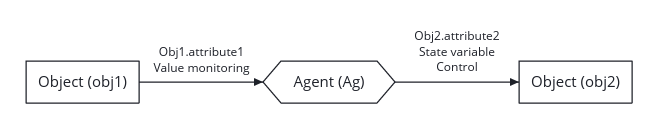

<div align="center">
    
    <h1>Lamda RED</h1>
    <p>
        <a href="../en/README.md">English</a> ·
        <a href="../ru/README.md">Русский</a> ·
        <a href="../fa/README.md">فارسی</a> ·
        <a href="../ar/README.md">العربية</a> ·
        <a href="../tr/README.md">Türkçe</a> ·
        <a href="../zh-CN/README.md">简体中文</a> ·
        <a href="../de/README.md">Deutsch</a> ·
        <a href="../es/README.md">Español</a> ·
        <a href="../ko/README.md">한국어</a>
    </p>
    <p>用纯文本绘制需求工程图</p>
</div>

Lamda RED 将纯文本 `.zz` 文件转换为需求工程图。你可以用图说明系统要实现哪些目标、可能遇到哪些风险，以及参与者和系统对象如何交互。把图表源文件和需求文档一起放在 Git 中，团队就能通过 diff 审查图表变更并重新生成图片。

用 **Drizzle** 编写图表，再用 **`lmdred`** 编译。编译器生成可放入文档的 PNG 和可在 diagrams.net (draw.io) 中编辑的 mxGraph XML。使用 `--export-set` 可导出紧凑版、文档版和高分辨率版 PNG。桌面版 VS Code 的配套扩展可在编辑器旁显示预览，并在保存时或点击 **Export diagram** 时导出。

## 从 Drizzle 到图表

示例中的参与者监测一个对象的值并控制另一个对象。下图是渲染结果。



将下面的示例保存为 `object-agent.zz`。

```drizzle
Input = [Object (obj1)]
Monitor = <Agent (Ag)>
Output = [Object (obj2)]

Input __> Monitor : Obj1.attribute1\nValue monitoring
Monitor __> Output : Obj2.attribute2\nState variable\nControl
```

安装编译器后，在该文件所在目录运行以下命令，即可生成 `object-agent.png` 和 `object-agent.xml`。

```sh
lmdred object-agent.zz object-agent
```

[安装](#installation) · [在 VS Code 中预览](../../README.md#live-preview-in-vs-code) · [阅读 Drizzle 语法](#drizzle-syntax)

- [命令行用法](#cli-usage)
- [Drizzle 语法](#drizzle-syntax)
- [Drizzle VS Code 扩展](./vscode.md)
- [安装](#installation)
- [源码与开发](#source-and-development)
  - [准备源码](#set-up-the-source)
  - [运行和调试](#run-and-debug)
  - [测试与检查](#test-and-check)
  - [构建与打包](#build-and-package)
  - [发布编译器版本](#publish-a-compiler-release)
- [更新日志](./CHANGELOG.md)
- [路线图](#roadmap)
- [许可证](#license)

<a name="cli-usage"></a>

## 命令行用法

可在任何目录运行已安装的命令。

```text
lmdred [input.zz] [output-stem]
lmdred --help
lmdred --version
```

| 参数或选项 | 含义 | 默认值 |
| --- | --- | --- |
| `input.zz` | UTF-8 编码的 Drizzle 源文件路径 | 当前目录中的 `sample.zz` |
| `output-stem` | 未附加 `.png` 和 `.xml` 扩展名的输出路径 | 当前目录中的 `output` |
| `-h`, `--help` | 显示命令行帮助 |  |
| `-V`, `--version` | 显示编译器版本，例如 `lmdred 1.2.0` |  |
| `--` | 将后续参数作为文件路径处理 |  |

<a name="output-paths"></a>

### 输出路径

相对路径以终端当前工作目录为基准。要选择其他位置，请传入绝对路径。输出目录必须已存在。编译器会在给定的文件基本名后附加扩展名。

| 命令 | 相对于当前目录写入的文件 |
| --- | --- |
| `lmdred sample.zz my-new-red` | `my-new-red.png` 和 `my-new-red.xml` |
| `lmdred sample.zz` | `output.png` 和 `output.xml` |
| `lmdred` | 读取 `sample.zz`，写入 `output.png` 和 `output.xml` |
| `lmdred diagrams/train.zz` | `output.png` 和 `output.xml` |
| `lmdred diagrams/train.zz reports/train` | `reports/train.png` 和 `reports/train.xml` |
| `lmdred sample.zz train.v1` | `train.v1.png` 和 `train.v1.xml` |

路径含空格时请加引号。路径以连字符开头时，先写 `--`（连字符为 `-`）。

```sh
lmdred "my diagrams/train.zz" "my diagrams/train"
lmdred -- "-file.zz" result
```

<a name="output-formats-and-errors"></a>

### 输出格式和错误

PNG 画布包含所有图形、连线及标签。mxGraph XML 包含可在 diagrams.net/draw.io 中编辑的图形、连线和路径控制点。

成功时会打印两个输出路径，并以状态码 `0` 退出。失败时将错误写入标准错误流，以状态码 `1` 退出。语法和引用错误会报告文件、行与列。

成功写入会覆盖目标路径上的现有输出。编译器检查输出不会覆盖源文件，并在写入任一输出之前完成解析和渲染。保存时发生文件系统错误，可能只写入其中一个输出。请检查错误消息，修复路径或权限后重试。

<a name="drizzle-syntax"></a>

## Drizzle 语法

可在文档和演示中使用 PNG。将 Drizzle 文件与需求一起保存，以便评审人员追踪和修改目标、风险、参与者和关系。每次编译也会生成可编辑的 mxGraph XML。

<a name="a-first-diagram"></a>

### 首个图表

将示例保存为 `first.zz`，然后执行 `lmdred first.zz first`。

```drizzle
&& The tracking agent reports train speed and location.
Tracking = <Tracking system>
Train = [Train]
Tracking __> Train : currentSpeed\ncurrentLocation
```

输出包括一个六边形参与者、一个矩形对象，以及一条指向列车的实线箭头。箭头上方的标签有两行。

<a name="declare-nodes"></a>

### 声明节点

用 `ID = shape` 声明可供连线引用的节点。ID 区分大小写，以 ASCII 字母开头，允许字母、数字以及字母或数字之间的单个下划线。`Train_1` 是一个 ID。图形中的文字是显示标签。连线可以写在节点声明之前或之后。以 `&&` 开头的行是注释。允许空行和缩进。

图形也可独立书写，例如 `/Safe journey/`。若要在连线中引用该图形，请为其定义 ID。

| 图形 | 声明 | 结果 |
| --- | --- | --- |
| 目标 | `G = /Safe journey/` | 向右倾斜的平行四边形 |
| 风险 | `R = \Signal lost\` | 镜像平行四边形 |
| 参与者 | `A = <Train controller>` | 六边形 |
| 描述性陈述 | `D = ~Doors are locked in motion~` | 底边较宽的梯形 |
| 对象 | `O = [Train]` | 矩形 |
| 动作 | `Send = (Send command)` | 椭圆 |
| 注记 | `N = {Controller responsibility}` | 浅绿色虚线边框矩形 |
| 云形注释 | `C = {{Reason for the obstacle}}` | 云形轮廓 |
| 菱形 | `Check = ^Speed confirmed?^` | 菱形 |

在图形前加上 `!` 可加粗轮廓。参考记法用它区分需求和假设等叶节点。标签保持正常字重。

```drizzle
/Goal/
!/Leaf requirement/
~Descriptive~
<Agent 1>
```

<a name="labels-and-line-breaks"></a>

#### 标签与换行

标签支持 UTF-8，包括从右至左的文本。渲染器测量文字、将其居中，并调整图形尺寸。长标签尽量按词换行，过长的词可在内部断开。图形标签最多显示四行，连线标签最多三行，超出部分以 `...` 表示。完整标签仍保留在源文件中。

| 语法 | 结果 |
| --- | --- |
| `/Accurate estimate\nof speed and position/` | 带换行的目标标签 |
| `[C:\\Logs]` | 标签为 `C:\Logs` 的矩形 |
| `<Speed \> zero>` | 标签为 `Speed > zero` 的参与者 |
| `/Input \/ output/` | 标签为 `Input / output` 的目标 |
| `~Value \~ threshold~` | 标签为 `Value ~ threshold` 的梯形 |

用 `\n` 强制换行，用 `\\` 显示反斜杠。若要在标签中显示分隔符，请在其前加反斜杠。

<a name="connect-nodes"></a>

### 连接节点

在运算符两侧使用节点 ID。中间两个字符决定线型。两侧的 `<` 和 `>` 分别为左端和右端添加箭头。可以在 ID 与运算符之间加空格以提高可读性。

| 方向 | 实线 | 虚线 |
| --- | --- | --- |
| 无箭头 | `A __ B` | `A -- B` |
| 指向 B | `A__>B` | `A-->B` |
| 指向 A | `A<__B` | `A<--B` |
| 指向两端 | `A<__>B` | `A<-->B` |

在连线及其选项后加冒号以添加标签。同一对节点之间的两条连线可有不同标签和独立路径。重复的连线只绘制一次。连接节点自身会形成自环。

```drizzle
Tracking = <Tracking system>
Train = [Train]
Tracking __> Train : currentSpeed\ncurrentLocation
Tracking <__ Train : measuredSpeed\nmeasuredLocation
Train --> Train : Refresh state
```

<a name="add-notation-to-a-connection"></a>

#### 添加连线标记

| 选项 | 示例 | 结果 |
| --- | --- | --- |
| `[o]` | `A __ B [o]` | 线上空心圆 |
| `[*]` | `A __> B [*]` | 线上实心圆 |
| `[zigzag]` | `A __ B [zigzag]` | 表示冲突的锯齿 |
| `[bar]` | `Risk --> Goal [bar]` | 表示障碍的横杠 |
| `[ortho]` | `A __> B [ortho]` | 由水平和垂直线段组成的走线 |

每条连线只能使用一种圆形、锯齿或横杠标记。该标记可以与 `[ortho]` 及任一线型组合。单向连线的横杠靠近箭头，无箭头或双箭头连线的横杠靠近路径中部。

<a name="join-several-sources"></a>

#### 合并多个源节点

指向同一目标的连线，在线型、标记、标签及走线选项相同时，共享末段。明确指定的绕行路径各自独立。可用逗号分隔源节点 ID，直接声明共享连线。空心圆或实心圆位于汇合点，右箭头指向目标，显式分支中的左箭头则分别指向各源节点。

```drizzle
layout up
Goal @1,0 = /Safe departure/
Software @0,1 = !/Verify the lock signal/
Assumption @2,1 = !/The door sensor works/

Software, Assumption __> Goal [o]
```

两个叶节点汇成一条带空心圆的连线，由一个箭头指向上方目标。将 `Software __> Goal [o]` 和 `Assumption __> Goal [o]` 分别写在两行，结果相同。

<a name="set-the-layout-and-routing"></a>

### 设置布局和走线

| 设置 | 示例 | 结果 |
| --- | --- | --- |
| 方向 | `layout right` | 从左到右自动布局，默认值 |
| 方向 | `layout left` | 从右到左自动布局 |
| 方向 | `layout up` | 从下到上自动布局，使用直角走线 |
| 方向 | `layout down` | 从上到下自动布局，使用直角走线 |
| 网格定位 | `Goal @2,0 = /Goal/` | 将图形放在第 2 列、第 0 行 |
| 外围走线 | `A --> B [bar] via bottom` | 让连线绕过图表底部 |

每张图最多使用一条布局指令。坐标从零开始，列向右递增，行向下递增。每个显式指定的单元格只能放一个节点。Lamda RED 根据图形调整行列大小，并让 PNG 画布容纳整张图。可混合自动和显式定位。

下图把对象与参与者示例放在第零行。虚线和交点展示网格坐标。高亮交点 `@0,2` 位于第零列、第二行。


```drizzle
Input @0,0 = [Object (obj1)]
Monitor @1,0 = <Agent (Ag)>
Output @2,0 = [Object (obj2)]

Input __> Monitor : Obj1.attribute1\nValue monitoring
Monitor __> Output : Obj2.attribute2\nState variable\nControl
```

要在高亮交点添加注记，请写 `Explanation @0,2 = {Column zero, row two}`。坐标选择单元格，其像素位置取决于图形尺寸。

在连线选项之后、标签之前写 `via right`、`via left`、`via top` 或 `via bottom`。这样可让冲突或阻碍关系绕开其他连线。

```drizzle
layout up
Login @0,0 = /User can sign in/
Blocked @0,1 = \User cannot sign in\
Recover @0,2 = /Recover using a phone number/

Recover __> Blocked
Blocked __> Login
Recover __> Login [zigzag] via right : A non-user might gain access
```

前两条连线沿树向上。冲突关系从右侧绕行并指向目标。

<a name="reference-diagrams"></a>

### 参考图表

每个示例展示对应 Drizzle 文件的编译结果。执行 `lmdred sample/de-morgan.zz de-morgan` 可生成德摩根图，也可替换为其他示例路径和输出基本名。

<a name="goal-notation-and-obstacles"></a>

#### 目标记法与障碍

粗轮廓标出叶节点，梯形记录描述性陈述，镜像风险图形经障碍横杠指向目标。说明放在云形图中。[Drizzle 源文件](../../sample/notation.zz)。


<a name="requirement-refinement"></a>

#### 需求细化

独立连线使被细化的需求和叶节点需求可使用各自的标记和箭头。[Drizzle 源文件](../../sample/requirements.zz)。


<a name="rail-goal-conflicts"></a>

#### 铁路目标冲突

分支在一个汇合点合并多个细化目标。锯齿连线连接树中互相冲突的目标。[Drizzle 源文件](../../sample/rail-conflicts.zz)。


<a name="authentication-risk"></a>

#### 身份验证风险

镜像图形表示阻止登录的问题。外侧锯齿连线表示恢复选项可能引入的冲突。[Drizzle 源文件](../../sample/auth-risk.zz)。


<a name="de-morgan-goal-and-risk-diagram"></a>

#### 德摩根目标与风险图

源文件显式声明目标及其否定、共享细化分支和三条虚线阻碍关系。[Drizzle 源文件](../../sample/de-morgan.zz)。


<a name="agent-monitoring-and-control"></a>

#### 参与者的监测与控制

六边形参与者接收第一个对象的属性，并控制第二个对象的属性。[Drizzle 源文件](../../sample/object-agent.zz)。


<a name="train-control"></a>

#### 列车控制

同一张图包含实线和虚线、测量和命令的独立箭头、动作椭圆及职责注记。[Drizzle 源文件](../../sample.zz)。


<a name="editor-and-diagnostics"></a>

### 编辑器与错误诊断

`drizzle/` 中的 VS Code 扩展可高亮 `.zz`、`.drizzle` 和 `.rd` 文件。要试用当前语法，在 VS Code 中打开该文件夹，按 **F5** 启动 Extension Development Host，并在宿主窗口打开图表源文件。[VS Code 扩展文档](https://code.visualstudio.com/api/get-started/your-first-extension)。

| 消息或现象 | 解决方法 |
| --- | --- |
| `unknown node 'X'` | 以相同大小写声明 `X`，或修正引用。 |
| `duplicate ID` | 为每个声明的节点分配唯一 ID。 |
| `cell @… is already occupied` | 将其中一个节点移至其他网格单元格。 |
| `invalid Drizzle syntax` | 根据消息中的文件、行和列，找到错误的分隔符、运算符或选项。 |
| `diagram is too large for PNG output` | 缩小网格位置之间的距离，或将模型拆分为多张图。 |
| `no system fonts found` | 安装无衬线字体并重新运行编译器。 |
| `link.exe not found` | 安装 MSVC 生成工具，或使用上述 GNU 命令。 |

<a name="installation"></a>

## 安装

发布工作流上传文件后，以下命令会下载编译器版本 `lmdred-v1.2.0`。

安装程序会选择 x64 或 ARM64，下载归档和 SHA-256 校验值，验证归档，并在当前用户账户下安装 `lmdred`。重新运行安装程序即可升级或修复。

<a name="linux-and-macos"></a>

### Linux 和 macOS

用 curl 下载并运行 Shell 安装脚本。

```sh
curl -fL https://github.com/Asncodes-80/lamda_red/releases/download/lmdred-v1.2.0/install.sh -o install-lmdred.sh
sh install-lmdred.sh
```

也可使用 wget 下载。

```sh
wget https://github.com/Asncodes-80/lamda_red/releases/download/lmdred-v1.2.0/install.sh -O install-lmdred.sh
sh install-lmdred.sh
```

默认目录是 `$HOME/.local/bin`。安装脚本会更新 `~/.profile` 和当前 Bash、Zsh 或 Fish 的启动文件。安装后打开新终端。也可以在当前 Bash、Zsh 或 sh 中立即启用此命令。

```sh
export PATH="$HOME/.local/bin:$PATH"
lmdred --version
```

使用下列选项选择版本或安装目录。

```sh
sh install-lmdred.sh --version 1.2.0 --bin-dir "$HOME/.local/bin"
sh install-lmdred.sh --no-modify-path
```

环境变量 `LMDRED_VERSION` 和 `LMDRED_INSTALL_DIR` 提供默认值。显式命令行选项优先。使用其他 Shell 时，请将安装目录加入其启动配置。

<a name="windows"></a>

### Windows

从 PowerShell 下载并运行安装程序。

```powershell
$installer = Join-Path $env:TEMP 'install-lmdred.ps1'
Invoke-WebRequest -Uri 'https://github.com/Asncodes-80/lamda_red/releases/download/lmdred-v1.2.0/install.ps1' -OutFile $installer
powershell -NoProfile -ExecutionPolicy Bypass -File $installer
```

打开新终端并运行 `lmdred --version`。安装程序将可执行文件放在 `%LOCALAPPDATA%\Programs\lmdred\bin`，并把该目录放在用户 PATH 的最前面，因此优先于经 Cargo 安装的副本。若系统级副本优先，安装程序会报告其路径。用 `Get-Command lmdred -All` 检查终端选中了哪个副本。

使用以下选项选择其他位置或自行管理 PATH。

```powershell
powershell -NoProfile -ExecutionPolicy Bypass -File $installer -Version 1.2.0 -InstallDirectory "$env:LOCALAPPDATA\Programs\lmdred\bin"
powershell -NoProfile -ExecutionPolicy Bypass -File $installer -NoModifyPath
```

`LMDRED_VERSION` 和 `LMDRED_INSTALL_DIR` 在 Windows 上也用于设置默认值。

<a name="download-an-archive-directly"></a>

### 直接下载归档

解压适合系统的归档，并将可执行文件放入 PATH 中的目录。

| 系统 | 处理器 | 发行归档 |
| --- | --- | --- |
| Windows | x64 | `lmdred-v1.2.0-x86_64-pc-windows-msvc.zip` |
| Windows | ARM64 | `lmdred-v1.2.0-aarch64-pc-windows-msvc.zip` |
| macOS | Intel | `lmdred-v1.2.0-x86_64-apple-darwin.tar.gz` |
| macOS | Apple Silicon | `lmdred-v1.2.0-aarch64-apple-darwin.tar.gz` |
| Linux | x64 | `lmdred-v1.2.0-x86_64-unknown-linux-musl.tar.gz` |
| Linux | ARM64 | `lmdred-v1.2.0-aarch64-unknown-linux-musl.tar.gz` |

Linux 发行版使用 musl，支持基于 glibc 和 musl 的发行版。Windows 发行版静态链接 C 运行库。渲染使用系统字体。在精简 Linux 服务器或容器中，请安装 DejaVu Sans 等无衬线字体。

<a name="install-from-source"></a>

### 从源码安装

安装 Rust 和平台构建工具后，在仓库根目录运行以下命令。

```sh
cargo install --path . --locked
```

Cargo 会将 `lmdred` 安装到 `~/.cargo/bin`，Windows 上则是 `%USERPROFILE%\.cargo\bin`。如有需要，请将该目录加入 PATH。也可直接从 GitHub 源码安装。

```sh
cargo install --git https://github.com/Asncodes-80/lamda_red --locked --bin lmdred
```

Windows GNU 工具链使用以下命令。

```powershell
cargo +stable-x86_64-pc-windows-gnu install --path . --locked
```

<a name="source-and-development"></a>

## 源码与开发

编译器读取 UTF-8 源文件，解析节点与连线，测量标签，计算布局和走线，并导出图表。

| 位置 | 职责 |
| --- | --- |
| [src/main.rs](../../src/main.rs) | 命令行参数、文件路径、错误和编译流程 |
| [src/lamda_red_grammar.pest](../../src/lamda_red_grammar.pest) | Drizzle 语法 |
| [src/parsing.rs](../../src/parsing.rs) | 图表模型、声明、引用和语法诊断 |
| [src/labels.rs](../../src/labels.rs) | 字体查找、文字塑形、换行和截断 |
| [src/layout.rs](../../src/layout.rs) | 图形几何、网格定位和画布边界 |
| [src/routing.rs](../../src/routing.rs) | 连线、分支、绕行路径和连线标签位置 |
| [src/export.rs](../../src/export.rs) | 生成 PNG 和 mxGraph XML |
| [sample.zz](../../sample.zz) 和 [sample/](../../sample/) | 列车控制及其他参考图表 |
| [tests/test_cli_install.py](../../tests/test_cli_install.py) | CLI 和发行版安装程序的集成检查 |
| [scripts/](../../scripts/) | 安装程序和发行归档打包 |
| [.github/workflows/release-cli.yml](../../.github/workflows/release-cli.yml) | 六个目标平台的构建、检查和发布 |
| [drizzle/](../../drizzle/) | VS Code 语法高亮扩展 |

<a name="set-up-the-source"></a>

### 准备源码

安装较新的稳定版 Rust 工具链、Cargo 和平台原生构建工具。CLI 和安装程序的集成检查需要 Python 3。发行版打包脚本可在 Windows PowerShell 5.1 或 PowerShell 7 中运行。PNG 渲染使用系统已安装的字体。[安装 Rust](https://www.rust-lang.org/tools/install)。

```sh
git clone https://github.com/Asncodes-80/lamda_red.git
cd lamda_red
cargo build --locked
```

在 Windows 上使用 MSVC 时，需要 Visual Studio C++ 生成工具。在 macOS 上安装 Xcode 命令行工具。在 Linux 上安装 C 编译器和链接器。精简的 Linux 环境还需安装字体，例如 DejaVu Sans。

在 Windows 上使用 GNU 工具链时，执行以下命令。对于本指南中的其他构建、运行、测试和安装命令，可将 `+stable-x86_64-pc-windows-gnu` 紧跟在 `cargo` 后面。

```powershell
rustup toolchain install stable-x86_64-pc-windows-gnu --profile minimal --component clippy,rustfmt
cargo +stable-x86_64-pc-windows-gnu build --locked
```

将 `Cargo.lock` 保留在版本控制中，并使用 `--locked` 采用已提交的依赖版本。

<a name="run-and-debug"></a>

### 运行和调试

Cargo 的开发构建包含调试信息。用以下命令编译参考图表。

```sh
cargo run --locked -- sample/requirements.zz target/requirements
cargo run --locked -- --help
cargo run --locked -- --version
```

第一条命令写入 `target/requirements.png` 和 `target/requirements.xml`。单独运行 `cargo run --locked` 会读取 `sample.zz`，并在仓库根目录生成 `output.png` 和 `output.xml`。

在 VS Code 中打开仓库根目录，安装 CodeLLDB，并将以下配置添加到 `.vscode/launch.json`。该配置使用 Cargo 构建 `lmdred`，通过相对于仓库根目录的路径打开示例。[CodeLLDB 配置参考](https://github.com/vadimcn/codelldb/blob/master/MANUAL.md#cargo-support)。

```json
{
  "version": "0.2.0",
  "configurations": [
    {
      "name": "Debug lmdred",
      "type": "lldb",
      "request": "launch",
      "cargo": {
        "args": ["build", "--locked", "--bin", "lmdred"],
        "filter": { "name": "lmdred", "kind": "bin" }
      },
      "args": ["sample/requirements.zz", "target/debug-diagram"],
      "cwd": "${workspaceFolder}",
      "env": { "RUST_BACKTRACE": "1" },
      "sourceLanguages": ["rust"]
    }
  ]
}
```

在 `run` 函数（位于 `src/main.rs`）中设置断点，然后按 **F5**。进入 `parsing::parse` 查看图表模型，进入 `layout::arrange` 检查位置和走线，进入 `export::png` 或 `export::xml` 检查输出。若需在调试配置中明确选择 GNU 工具链，请将 Cargo 参数改为 `["+stable-x86_64-pc-windows-gnu", "build", "--locked", "--bin", "lmdred"]`。

<a name="test-and-check"></a>

### 测试与检查

在仓库根目录运行 Rust 测试、格式检查和静态检查。

```sh
cargo test --locked
cargo fmt --check
cargo clippy --locked --all-targets -- -D warnings
```

Rust 测试涵盖解析、引用、标记、分支、向后兼容性、绕过障碍物以及文字的换行与截断。

要检查 CLI 和安装程序，请构建发行版可执行文件，并将其路径传给集成检查。

```sh
cargo build --locked --release
python tests/test_cli_install.py --binary target/release/lmdred
```

在 Windows 上使用 `target/release/lmdred.exe`。明确指定 Rust 目标时，使用 `target/<target>/release/lmdred` 或 `lmdred.exe`。集成检查在仓库外渲染图表，验证带空格的路径和默认输出，并通过本地 HTTP 提供发行归档。它在临时目录安装和重新安装，确认损坏的校验和会被拒绝，且已安装的可执行文件保持可用。

<a name="build-and-package"></a>

### 构建与打包

```sh
cargo build --locked
cargo build --locked --release
```

开发构建写入 `target/debug/`，优化构建写入 `target/release/`。Linux 和 macOS 上的文件名为 `lmdred`，Windows 上为 `lmdred.exe`。

在 Windows 上先构建目标，再用 Windows PowerShell 5.1 打包。使用 PowerShell 7 时，用 `pwsh` 替代 `powershell.exe`。

```powershell
$compilerTarget = ((rustc -vV | Select-String '^host: ').Line -split ': ', 2)[1]
cargo build --locked --release --target $compilerTarget
powershell.exe -NoProfile -ExecutionPolicy Bypass -File .\scripts\package-release.ps1 -Target $compilerTarget
```

两个步骤均使用当前 Rust 工具链的目标。Windows x64 的目标为 `x86_64-pc-windows-msvc` 或 `x86_64-pc-windows-gnu`。可执行文件位于 `target/<target>/release/`。归档和对应的 `.sha256` 文件写入 `target/dist/`。每个归档均包含可执行文件、许可证、README 和 `sample.zz`。Unix 目标使用 `.tar.gz` 归档。

<a name="publish-a-compiler-release"></a>

### 发布编译器版本

发布工作流为 Windows、macOS 和 Linux 构建并测试 x64 和 ARM64 原生可执行文件，上传各平台归档、SHA-256 校验和、两个安装脚本及汇总的 `SHA256SUMS` 文件。

提交并推送源码后，发布与 `Cargo.toml` 中版本匹配的标签。

```sh
git tag lmdred-v1.2.0
git push origin lmdred-v1.2.0
```

标签将启动工作流。所有构建通过后，工作流会创建编译器发行版。在 GitHub 上使用同一标签手动发布也会启动工作流并附加产物。**Run workflow** 按钮为所选分支构建可下载的 Actions 产物。

后续发布前，更新 `Cargo.toml` 和 `Cargo.lock` 中的编译器版本、两个安装脚本的默认版本以及 README 中带版本号的安装命令，再推送对应标签。编译器标签以 `lmdred-v` 开头。VS Code 扩展使用 `drizzle-` 标签和 `drizzle/package.json` 中独立的版本号。

<a name="roadmap"></a>

## 路线图

- 为 Lamda RED 的 Pest 语法创建状态机图。
- 开发 Web 服务，由 React 应用向 Rust 服务器请求渲染好的 PNG。

<a name="license"></a>

## 许可证

本项目采用 [GNU GPLv3](../../LICENSE) 许可证。
